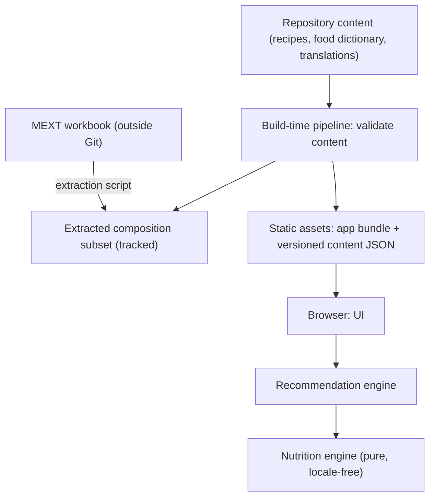

English | [日本語](../ja/ARCHITECTURE.md) · [Docs index](README.md)

# Architecture — Recipe Discovery

This document describes how Recipe Discovery is built: the layers and their boundaries, the data model, localization, the build-time pipeline, the recommendation flow in the browser, platform independence, security, and testing. It is for developers who change code or content. Commands and the current directory layout are in [DEVELOPMENT.md](DEVELOPMENT.md).

Status: **In use**. Drafted on 2026-10-18 and implemented in Phases 0–10. Decisions are recorded in [DECISIONS.md](../working/DECISIONS.md) (ADR-001 to ADR-014 and later ADRs).

## 1. Overview

The MVP is a **static single-page application**. All content is prepared at build time, and all calculation runs in the browser.

- The pipeline checks schemas, locale completeness, food mappings, allergens, and policy lint, and keeps nutrition regression snapshots (§5).
- No application server, database, admin UI, or AI in the MVP (ADR-002, ADR-004).
- Hosting: Cloudflare static assets, with platform-specific configuration isolated (ADR-001).

## 2. Layers and responsibilities

| Layer | Responsibility | Must not depend on |
|---|---|---|
| `domain/nutrition` | Amount resolution for a recipe state (servings, sides, linked ingredients, chosen substitutions), per-ingredient and per-recipe nutrition, cooking-state handling, uncertainty classification, ranges, rounding for display values (ADR-028) | UI, i18n, locale, platform, network |
| `domain/recommendation` | Hard filters, fit evaluation, fit tiers, diversification, seeded re-suggestion, bounded adjustment solver, substitution suggestions, relaxation suggestions, contradiction checks | UI, i18n, locale, platform, network |
| `domain/shopping` | Shopping list aggregation (ADR-032): items from recipe states with `resolveAmounts` of `domain/nutrition`, combination by food ID, sections, order, frying oil, household measure totals; no nutrition values | UI, i18n, locale, platform, network |
| `shared` | Content schemas and types, IDs, units, constants used by build tools, domain, and UI; the contract and output validation of the free-text conditions (`shared/suggestion.ts`, §7); the deterministic free-text parser and its word lists (`shared/freeText/`, ADR-034 revised again) and the search normalization (`shared/search.ts`), used by the UI and by Node tools | UI, platform |
| `content/` (data) | Recipes, food dictionary, allergen links, substitutions, localized texts, glossary | — |
| `tools/` (build time) | Composition extraction, content validation, policy lint, nutrition snapshots, header generation | UI |
| `src/` (UI) | React app, navigation, i18n, formatting, state, accessibility ([UI_DESIGN.md](UI_DESIGN.md)) | Platform-specific APIs |
| `platform/` | Hosting configuration (Cloudflare) and generated security headers | Domain logic |

Lint import restrictions and a boundary test enforce these boundaries, as in the owner's other projects. The directory layout: [DEVELOPMENT.md](DEVELOPMENT.md) "Layout (current)".

## 3. Data model (outline)

The schema is `shared/content.ts` (ADR-026). Calculation rules are in [NUTRITION_CALCULATION.md](NUTRITION_CALCULATION.md).

- **Food**: locale-neutral `id` (stable slug); `composition` references (food code and data version per cooking state, for example `raw` and `grilled`); weight change rates per cooking method; refuse rate; allergen links with confidence (`contains`, `may_contain`, `unknown`); localized `names` and search `aliases` for every locale (`ja`, `en`, `es`, `fr`).
- **Recipe**: `id`; time; effort; cuisine; goals; main protein group; tags; equipment; servings; ingredients; sides; keyed steps and food safety notes; substitutions; localized texts. "Quick" and "fried" are derived.
- **RecipeIngredient**: food ID; raw edible grams; cooking state and method; household measure (unit and quantity); role; adjustment bounds (grams or whole units); `linkedTo` leader; hard-to-estimate marker.
- **Side**: localized label, ingredients, and whether "fit to my targets" may switch it off.
- **Substitution**: from food to food with a ratio, optional bounds, and replaced step texts and safety notes.
- **Composition subset**: per food code, the selected nutrient values with their notation flags (`measured`, `estimated`, `trace`, `zero`, `unmeasured`), source version, and checksum manifest.

## 4. Localization

- Library: i18next with typed TypeScript message catalogs, the owner's established approach (ADR-005).
- UI catalogs: `ja` defines the message type; `en`, `es`, and `fr` must match it at compile time.
- Content: every recipe and food carries `ja`, `en`, `es`, and `fr` texts; the build fails on missing or blank entries.
- **Food identity is separate from translation** (ADR-006). Ingredients reference locale-neutral food IDs; names and aliases are display and search data only. Nutrition functions do not accept a locale parameter, and their types enforce this.
- Search normalization per locale:
  - `ja`: Unicode NFKC and hiragana/katakana folding. A long-vowel mark in the query also matches the vowel it lengthens and, after o- and e-row kana, う or い.
  - `en`: case folding.
  - `es`: case and accent folding.
  - `fr`: case and accent folding, with `œ` and `æ` read as `oe` and `ae`.
  - Aliases cover regional terms (for example `patata` / `papa`).
- Household units are display labels per locale (大さじ / tbsp / cucharada). Amounts are stored in grams; a tablespoon is defined as 15 mL.
- Formatting uses `Intl` APIs. Values are formatted only at the presentation layer.
- Locale detection and persistence (same pattern as the owner's other apps, `src/i18n/localePreference.ts`): the stored locale preference if valid, otherwise the first supported language in `navigator.languages`, otherwise `ja`. Only the locale preference is stored.

## 5. Build-time pipeline

1. **Extraction**: a script reads the MEXT workbook from `data/raw/` (git-ignored) and checks its SHA-256 against the manifest. It writes only the food codes referenced by the food dictionary and only the selected columns, with notation flags. Output and manifest are tracked ([DATA_SOURCES.md](DATA_SOURCES.md)).
2. **Content validation**: schemas; unique IDs; every ingredient maps to a food and every food to composition data; locale completeness; adjustment bounds valid; substitutions valid; allergen links present (or explicitly `unknown`).
3. **Policy lint**: forbidden health or efficacy expressions in all locales ([CONTENT_POLICY.md](CONTENT_POLICY.md)).
4. **Nutrition snapshots**: per-recipe calculated values are stored as test snapshots, so data or formula changes produce a reviewable diff.
5. **Content bundles** (ADR-027): `tools/build-content.ts` writes a locale-neutral calculation bundle and one text bundle per locale to `generated/content/` (git-ignored). Vite adds a content hash to each file name.
6. **Header generation**: security headers are defined once and written in the hosting platform's format.

## 6. Recommendation flow (browser)

1. Load the calculation bundle and the text bundle of the active locale (static, content-hashed) (`src/content/`). Validate them with `zod/mini` and against each other. When a bundle is unreachable or invalid, show the error state with a retry action. Switching the locale loads only its text bundle, before the language changes, so the views stay mounted.
2. Validate user inputs and detect contradictory targets (`src/views/TargetsView.tsx` with `domain/recommendation`).
3. Hard filters → fit evaluation (default amounts, then bounded adjustment) → fit tiers → diversification → stable ordering, on the main thread (ADR-030 D10). The solver results that do not depend on the targets are computed once per calculation bundle, after the first view is shown (`src/state/providers.tsx`, `withPrecomputed` in `domain/recommendation/data.ts`). A search gives the same result with or without them.
4. Render candidates and deterministic reason texts from the typed catalogs (`src/views/candidates/`).
5. Recalculate on every adjustment in the detail view (`src/views/DetailView.tsx`). Timing is in the next list.
6. State stays in memory (`src/state/`, ADR-015, ADR-030 D9). Only the recipe detail and the about page have their own URLs (`src/navigation/`, ADR-030 D2).
7. The shopping list (ADR-032) keeps the recipe states the user added in memory. `domain/shopping` aggregates them only when the list changes or is shown, never during a recommendation.

Timing measured in the browser:
- Desktop (Stage 4.7): a full recommendation about 25 ms inside the UI; a re-suggestion about 2 ms and a recalculation about 3 ms from click to layout.
- 4× CPU slowdown, release 7 with 130 recipes: a full recommendation about 54–59 ms median and 62–66 ms p90 ([DECISIONS.md](../working/DECISIONS.md) "Phase 10 acceptance"). This is within the 100 ms threshold of ADR-030 D10 (revised).
- Earlier at 4×: 66 ms in Stage 6.2 on 60 recipes; about 80–88 ms before Stage 9.3; about 50 ms after Stage 9.3.

## 7. Platform independence

- The production output is a plain static build (`dist/`). Only `platform/cloudflare/` and the generated header file are Cloudflare-specific.
- No Cloudflare runtime APIs are used by domain, content, or UI code. Tests run in Node.
- The static app needs no Worker. A future server feature defines its HTTP contract in `shared/` and keeps the provider-specific implementation in a thin adapter. The free-text conditions (ADR-034, revised again) need no server: they are parsed in the browser.
- The deployment runbook ([DEPLOYMENT.md](DEPLOYMENT.md)) describes Cloudflare (`platform/cloudflare/wrangler.jsonc`) and how to serve the same `dist/` from other static hosts. Hashed files under `/assets/` get a one-year immutable cache rule in the generated `_headers`.

### Free-text conditions

The user may describe the dish in their own words. A deterministic parser in the browser reads conditions from the text, the UI shows them, and only the conditions the user applies reach the engines (ADR-034, revised again). The text is sent nowhere and not stored, and no AI is involved.

1. **Read**: `parseConditions(text, locale, foods)` (`shared/freeText/parse.ts`) with the word lists of `shared/freeText/lexicon.ts` and the dictionary from the bundles (`parserFoods`). The same text, locale, and dictionary always give the same result.
2. **Validate**: `validateValue` (`shared/suggestion.ts`) checks the strict schema (allowed fields and enum values, length limits), that every food ID is in the dictionary, and that no food is both required and excluded. Duplicates are removed.
3. **Show**: conditions as a labelled list with "apply" and "discard"; a declined topic as a message (for allergens, with a button that moves focus to the allergen choices); nothing recognized as "no conditions found". Any failure leaves the form unchanged.
4. **Apply** (`src/views/targets/freeText.ts`): required items and excluded foods are added to the chosen ones (a whole protein group keeps its group chip), cuisines are added, and a stated time limit and equipment replace the current ones. Targets and allergens are never changed.

- **Output**: `{ "kind": "conditions", "conditions": … }` or `{ "kind": "out_of_scope", "topic": "allergens" | "targets" | "other" }`. Conditions have the shape of the engine's `Conditions`: `requiredFoods` (up to 5 any-of sets of up to 12 food IDs), `excludedFoods` (up to 20 food IDs), optional `maxMinutes` (a whole number from 5 to 240, the engine's input limits), optional `equipment` (the equipment the user has), and `cuisines`. There is no free-text field.
- **Request**: the trimmed text has 1–200 Unicode code points (`suggestRequestSchema`).
- **Evaluation**: `npm run eval:ai` runs the parser on the evaluation set through the same validation ([DEVELOPMENT.md](DEVELOPMENT.md) "Data and evaluation").

## 8. Security and privacy

- Strict Content-Security-Policy (`'self'` only), `X-Content-Type-Options: nosniff`, `Referrer-Policy`, restrictive `Permissions-Policy`, `frame-ancestors 'none'`.
- No third-party scripts, fonts, or images at runtime.
- No user data leaves the browser. The free-text conditions are parsed in the browser (ADR-034, revised again; ADR-015). Targets and conditions are never put in URLs.
- Conditions read from free text hold no nutrition values, allergens, health statements, cooking temperatures or times, or free text, and pass the same validation as every other suggestion (§7).
- Dependency install scripts are governed by an allowlist policy (Phase 0).

## 9. Testing strategy

- Unit tests for the nutrition and recommendation engines: determinism, rounding, uncertainty, adjustment bounds, diversity, relaxation suggestions, contradictions.
- Unit tests for the shopping list aggregation: combination, scaling, sides, substitutions, order, determinism, locale independence.
- **Locale invariance test**: every recipe calculated under each locale context yields identical internal values.
- Content validation and policy lint run in CI and in the build.
- Nutrition snapshot tests.
- UI tests with jsdom: `src/**/*.test.tsx` with fixtures, and `test/ui/` with the repository content.
- Accessibility checks (axe-core, without the contrast rule) in every locale for every view and exceptional state. A contrast test covers the color tokens (`test/node/styles.test.ts`).
- E2E tests (`e2e/`, Playwright) on the production build with its headers:
  - browsers: desktop Chromium, and Chromium and WebKit at 375 px, in every locale;
  - coverage: the full flow, exceptional states, locale switching, deep links, the about page, keyboard operation, axe-core with color contrast in light and dark, security headers, no request to another origin, and no CSP violation.
- Phone-class timing runs on demand (`npm run test:e2e:timing`).

## 10. Not in the MVP

D1 or any database, admin UI and authentication, application server, AI provider, analytics. Their absence is intentional (ADR-002, ADR-004, ADR-015).
