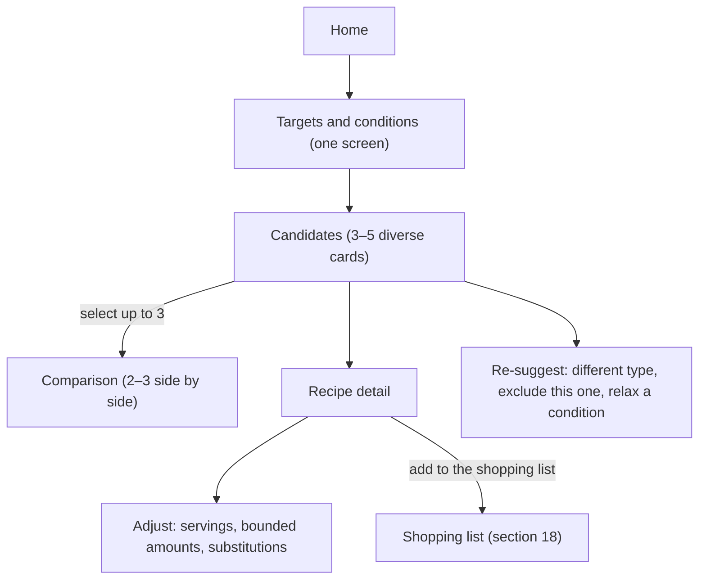

English | [日本語](../ja/SPEC.md) · [Docs index](README.md)

# Product Specification — Recipe Discovery

This specification defines what Recipe Discovery does for its users: the product goal, target users, scope, user flow, inputs, ranking, displays, and acceptance criteria. It is for anyone who decides or checks product behavior. Calculation rules, content rules, and screen designs are in their own documents and linked from the sections below.

Status: **In use**. Drafted on 2026-10-18; the placeholder values of Phase 0 are decided (§16). Decisions and their status are recorded in [DECISIONS.md](../working/DECISIONS.md).

## 1. Product goal

The app helps nutrition-conscious users find dishes that fit their nutrition targets and practical conditions and that they would not have thought of on their own. It widens the user's cooking repertoire: it presents several diverse candidates, explains how each one fits the targets, and lets the user compare, adjust, and choose.

This is not an AI recipe generator. Recipes are curated, structured content. Nutrition values are calculated deterministically from food composition data and explicit amounts.

Core values:
- Support nutrition targets such as high protein, low fat, and calorie ranges.
- Calculate nutrition from food composition data and stated amounts, never from AI self-reporting.
- Consider cooking time, effort, preferences, exclusions, and optionally required ingredients.
- Present diverse candidates and explain why each was chosen and how it fits the targets.
- Never present uncertain values or food mappings as exact.
- Be explicit about the limits of allergen filtering; never guarantee allergen safety.

## 2. Target users and scenarios

| Persona | Scenario | Typical conditions |
|---|---|---|
| P1 Office worker in a cutting phase (primary) | Weeknight dinner; wants something new instead of the usual chicken and broccoli | ~500–650 kcal per meal, protein ≥ 35 g, fat ≤ 15 g, ≤ 20 min |
| P2 Student in a bulking phase | Filling, high-protein meals with low effort | ~800 kcal, protein ≥ 45 g, low effort |
| P3 Batch cook | Cooks several servings on the weekend | Multiple servings, interest in storage notes |
| P4 Strict pre-competition dieter (caution) | Tight fat and calorie control | The app's estimates may not be precise enough; the UI must say that strict control requires weighing and checking product labels |

Out of target: people following medically prescribed diets (for example protein restriction for kidney disease, or diabetes management). The target settings show a notice that people under medical or dietitian guidance should follow that guidance.

## 3. Scope

### MVP / P0
- Nutrition targets per meal: presets (cut / maintain / bulk) and custom values.
- Conditions: maximum time, effort, cuisine and style preferences, excluded ingredients, allergen exclusion (best effort), equipment, and optional required ingredients.
- 3–5 diverse candidates per request, with comparison of 2–3 candidates side by side.
- Recipe detail: ingredients with amounts, steps, nutrition breakdown, calculation basis, uncertainty, food safety notes, attribution.
- Serving count changes, bounded amount adjustment, predefined substitutions, and instant recalculation.
- Re-suggestion: "show a different type", "exclude this one", and relaxation suggestions when few candidates exist.
- Japanese, English, and Spanish for UI and all content, with a visible language switcher. French was added in Phase 11 (ADR-033).
- Exceptional-state UX (section 12).

### Added after the MVP
- Shopping list (Phase 8, ADR-032): section 18.
- Optional free-text conditions (Phase 12, ADR-034; released in release 9): the user describes a request in their own words, and the app reads conditions from the text with deterministic rules and shows them to apply or discard. No AI is used. Targets, allergens, and every calculation stay deterministic, and the app works fully without it.
- Saved targets and conditions (Phase 13, ADR-036; released in release 10): the user can turn on saving in the targets view. The form is then kept in this browser on this device and restored into the form on the next visit, without starting a search. Allergen choices are saved only with a separate checkbox. Saving is off by default, and turning it off or the delete action removes what was saved.

### Out of scope for MVP
- User accounts, server-side storage, daily or weekly meal planning.
- AI at runtime (recipe generation, AI explanations, AI substitution suggestions, AI reading of free text).
- Packaged-product nutrition (barcodes, Open Food Facts), prices, external service integrations, analytics.
- Photos other than original photos owned by the project (none planned for the MVP).
- Regional ingredient availability (only a note where an ingredient may be hard to find).

## 4. User flow

- The targets and conditions screen has quick inputs (target preset, maximum time) and a collapsible advanced part: kcal, protein, fat, and carbohydrate values, effort, preferences, exclusions, allergens, equipment, and required ingredients.
- Adjusting recalculates instantly and shows the differences.
- In the shopping list, the user can check items off, copy the list, and print it.
- The flow state stays in memory. Targets and conditions are never put in the URL, so body-related targets do not end up in history or referrers.
- Nothing except the locale preference is stored in the browser in the MVP (section 16, ADR-030 D9). The shopping list also stays in memory (section 18).

## 5. Inputs

| Input | Default | Required | Kind |
|---|---|---|---|
| Target preset (cut / maintain / bulk) | maintain | Yes (preset fills the values) | Fills the values below |
| Calories per meal (range) | from preset | Yes | Soft (ranking tier) |
| Protein minimum | from preset | Optional | Soft (ranking tier) |
| Fat maximum | from preset | Optional | Soft (ranking tier) |
| Carbohydrate range | none | Optional | Soft (ranking tier) |
| Servings | 1 | Yes | Calculation basis |
| Maximum cooking time | none | Optional | **Hard** |
| Effort (3 levels) | none | Optional | Soft |
| Cuisine and style preferences | none | Optional | Soft |
| Excluded ingredients | none | Optional | **Hard** |
| Allergen exclusion | none | Optional | **Hard, best effort** ([CONTENT_POLICY.md](CONTENT_POLICY.md)) |
| Equipment (for example microwave only) | none | Optional | **Hard** |
| Required ingredients ("ingredients I want to use") | none | Optional | **Hard** (recipes must contain all of them) |

- Nutrition targets are not hard filters. Because of estimation error, borderline recipes would disappear and empty results would become common. Fit tiers are used instead (section 6).
- Preset values are examples, not advice. The app does not calculate targets from body weight or other personal data.
- Ingredient inputs (required, excluded) are chosen from the food dictionary with locale-aware autocomplete, so unsupported ingredients cannot be entered. Search uses localized names and aliases ([ARCHITECTURE.md](ARCHITECTURE.md) "Localization").
- Input validation detects contradictory targets before searching (section 12).

## 6. Ranking, diversity, and re-suggestion

1. Apply hard constraints.
2. For each remaining recipe, evaluate the target fit at the default amounts and, where allowed, with bounded amount adjustment (section 8).
3. Group recipes into fit tiers: all targets met, some targets near (within tolerance), some targets not met.
4. Within the best available tier, select candidates with a deterministic diversification step. The set varies in main protein source, cuisine, and cooking method. Remaining ties use preference scores, then the smaller amount change, then a seeded order with the recipe ID as the last tie-break.
5. "Show a different type" draws the next diverse set from the same eligible pool in a seeded, reproducible order. It excludes candidates already shown in the session.

Details are in the ADRs:
- Tolerance: ADR-025.
- ADR-029: fit evaluation with ranges, tiers, the solver objective, diversification (with a derived cooking-method family), preferences as a lexicographic key without weights, the seeded order, hard filters, relaxation, and contradiction checks.

## 7. Candidate card and recipe detail

Candidate card:
- Recipe name, time, effort.
- kcal / protein / fat / carbohydrate per serving, each shown against the target band with a status: met, near, or not met; unknown when a source value is unmeasured.
- "Adjusted" badge with the adjustment summary when amounts were adjusted (for example "chicken breast 120 g → 160 g").
- One-line deterministic reason (for example "Meets the protein target with the lowest fat of these candidates").
- Uncertainty badge when the estimate includes approximations; allergen notice when relevant.
- Required ingredients used, when the user specified any.

Recipe detail:
- Ingredients with grams and the authored household measure, each with its food mapping (food name, food code, raw or cooked state).
- Nutrition per ingredient and per serving, with totals.
- Uncertainty details (approximations, assumptions, trace values).
- Steps, food safety notes, substitutions, adjustment controls.
- Attribution: 「日本食品標準成分表（八訂）増補2023年から引用」, a statement that the values are this app's own calculated estimates, and the data version.
- Disclaimers: estimates only; allergen filtering is not a guarantee.

## 8. Adjustment, substitution, and recalculation

- All recalculation runs in the browser with deterministic functions and updates instantly. The view shows the differences from the previous state (for example "protein +8 g, fat +3 g") and status changes.
- Servings scale every ingredient.
- Bounded adjustment: each recipe defines which ingredients may change, their minimum and maximum, step size, and linked ingredients (for example seasonings scale with the main ingredient). Integer units are respected (for example whole eggs). Steps may define notes that appear above a threshold (for example "use a larger pan").
- "Fit to my targets" is in the MVP (ADR-024). It selects the in-bounds amounts of the main protein and carbohydrate that meet the targets with the smallest change from the default amounts.
- Sides (rice, potatoes, vegetable sides) can be switched on and off. The solver may switch off carbohydrate sides only, and a side that stays on keeps at least its authored minimum portion (ADR-026).
- Substitutions come only from each recipe's predefined substitution list. They may switch related notes and times.

## 9. Nutrition display and uncertainty

The rules are in [NUTRITION_CALCULATION.md](NUTRITION_CALCULATION.md). User-facing behavior:
- Values are labelled as estimates.
- Each ingredient's contribution, food code, data version, and cooking state are visible.
- Uncertainty classes:
  - exact mapping;
  - approximation: similar food, raw or related cooked value used for a cooked ingredient, fried foods with a tabulated fried form;
  - hard to estimate: slow frying in a lot of oil, fried foods without a tabulated form.
- Household measures such as "a pinch" are display aids; the calculation uses the stated grams.
- Approximations are explained; large uncertainty is shown as a range.
- When a value range straddles a target boundary, the status is "near / uncertain", never "met".
- Energy is taken from the source tables and may not equal 4P + 9F + 4C; the detail view explains why.

## 10. Localization

- Locales: `ja`, `en`, `es`, `fr` (`fr` since Phase 11, ADR-033). Default and detection behavior follows [ARCHITECTURE.md](ARCHITECTURE.md) "Localization".
- Localized: UI strings, recipe names, ingredient display names and search aliases, steps, notes, substitutions, validation and error messages, accessibility labels, document language metadata.
- Every published recipe and food must have complete content in every locale; the build fails otherwise. Published content therefore needs no runtime fallback.
- Numbers and units are formatted per locale (for example a decimal comma in Spanish and French). Underlying values never change.
- Calculated nutrition values are identical in every locale.

## 11. Allergens, food safety, and health expressions

The rules are in [CONTENT_POLICY.md](CONTENT_POLICY.md). Summary:
- Allergen exclusion is best effort. Ingredients with unknown allergen information are treated as "may contain". The app never claims a recipe is safe for allergic users.
- Every recipe includes the relevant food safety notes (for example cooking meat through; handling hot oil).
- No health, medical, or efficacy claims.

## 12. Exceptional states

| Situation | Behavior |
|---|---|
| No candidates | Show how many recipes each hard constraint excluded and deterministic relaxation options with resulting counts (for example "allow 30 minutes: +4 recipes") |
| Fewer than 3 candidates | Show them, then clearly separated "close alternatives" with the unmet targets (for example "fat +4 g over") |
| Contradictory targets | Detect before searching (for example a protein minimum whose energy alone approaches the calorie maximum) and explain |
| Required ingredients leave too few recipes | Same as no or few candidates, including "remove this required ingredient: +N" |
| Allergen data unknown for an ingredient | Excluded when an allergen filter is active, with the reason shown |
| Content fails to load | Retry action (content is static, so this should be rare) |
| Unsupported ingredient | Not possible through the dictionary input; the autocomplete shows "not supported" when nothing matches |

## 13. Privacy and security

- No accounts and no server-side storage in the MVP; the MVP has no application server.
- Targets and conditions stay in the browser and are not put in URLs.
- Saved conditions (ADR-036) are stored only after the user turns saving on, in one `localStorage` record on the device. They are never sent or put in a cookie, and anyone using the same browser can see them, which the UI says. Allergen choices need a separate checkbox. Without saving, only the locale preference is stored.
- The shopping list stays in memory. Copying and printing it are browser features started by the user and send nothing (section 18).
- No analytics or trackers by default.
- Strict security headers (Content-Security-Policy and related headers) on all responses.
- Any future server endpoint must validate inputs and outputs at runtime and must not log user targets or conditions.
- The free-text conditions (Phase 12, ADR-034) are read in the browser. The typed text is sent nowhere and is not stored.

## 14. Accessibility and UX

- Responsive layout for mobile and desktop; mobile-first.
- Semantic HTML, keyboard operation, visible focus, labelled controls, correct `lang` attributes.
- Comparison and nutrition bars must not rely on color alone; values are always available as text.
- Reduced-motion support.
- Accessibility checks run in every locale.

## 15. MVP acceptance criteria

- The complete flow (targets → conditions → candidates → comparison → detail → adjustment → re-suggestion) works on mobile and desktop without AI.
- The same input and data always produce the same candidates, order, and nutrition values.
- For the same recipe and amounts, internal nutrition values are identical in every locale.
- All UI strings and all published content exist in every locale (checked at build time).
- Every nutrition value is traceable to food codes, data version, cooking state, and assumptions.
- Unmeasured source values are never treated as zero; approximations and hard-to-estimate items are always shown.
- An active allergen filter excludes recipes with matching or unknown ingredients, and the disclaimer is always visible.
- No content contains health or efficacy claims (content validation).
- Attribution to the source tables is shown.
- Lint, type-check, unit tests, content validation, E2E tests, accessibility checks in every locale, and the production build pass.

## 16. Decided values

These values started as Phase 0 placeholders; all are now decided.

| Item | Value | Decided in |
|---|---|---|
| Fit tolerance | ±10% (protein: up to 3 g below the minimum) (ADR-025) | Phase 0 |
| Display rounding | kcal to 10, protein/fat/carbohydrate to whole grams; status from full precision (ADR-025) | Phase 0 |
| Range display rule | Per-ingredient error bands by reason; range shown when wider than twice the display unit (ADR-025) | Phase 0 |
| Recipe library size | About 60 for the MVP, with composition rules (ADR-023); revised to about 86 (Phase 7) and about 130 (Phase 10) | Phase 0; revised in Phases 7 and 10 |
| Amount adjustment scope | Main protein and carbohydrate only, with sides that can be switched off (ADR-024, revised in Phase 1) | Phase 0 |
| Browser storage of targets and viewed recipes | None in the MVP; only the locale preference is stored (ADR-030) | Phase 4 |
| Preset values | cut 450–650 kcal / P ≥ 35 g / F ≤ 15 g; maintain 550–750 / ≥ 30 / ≤ 20; bulk 750–950 / ≥ 45 / ≤ 30 (ADR-025) | Phase 0 |

## 17. Open questions (要確認)

Tracked in [DECISIONS.md](../working/DECISIONS.md) "Open questions".

## 18. Shopping list (Phase 8)

The shopping list turns one or more recipes, in the state the user chose, into one list of what to buy. It has no prices, stores, package sizes, stock tracking, or meal planning. Decisions and alternatives: ADR-032 in [DECISIONS.md](../working/DECISIONS.md). Screens and text format: [UI_DESIGN.md](UI_DESIGN.md) §3.7.

### Adding recipes

- Recipes are added from the recipe detail only. "Add to the shopping list" copies the recipe's current state into the list: servings, adjusted amounts, sides on or off, and substitutions.
- The list has one entry per recipe and at most 10 recipes. To cook a recipe twice, the user raises its servings.
- When the detail state later differs from the list entry, the detail view offers "update the list" and "remove from the list". The list never changes by itself.
- Provenance: the list shows each recipe with its name (a link to its detail), its servings, and a summary of its changes (amounts adjusted, sides switched off, substitutions). Each item can show its amount per recipe.

### Amounts

- The amounts are the grams that `domain/nutrition` resolves for the recipe state (`resolveAmounts`), the same amounts as the detail view.
- A side switched off contributes nothing. A substitution lists the substitute food.
- Ingredients counted as included in another ingredient's cooked value (cooking oil, coatings) are listed, because they are needed for cooking.
- The list neither shows nor computes nutrition values.
- Basis: grams are the raw edible portion (without skin, bones, or shells) or the weight as sold (`as_is` foods), and the list says so. Purchase amounts from refuse rates are not shown.

### Combining items

- Items are combined by food ID. Every food is used on a single basis: always as sold, or always raw edible grams.
- Forms that are bought differently are different foods (cooked rice and dry pasta, tomatoes and canned tomatoes). So the cooking state never splits an item.
- Frying oil (an oil ingredient included in a fried or slow-fried ingredient) is a separate item. It is not added to the same oil used otherwise, and it carries a note that the amount depends on the pan.
- Totals are computed at full precision and rounded only for display, like the ingredient grams of the detail view (up to one decimal).
- A total household measure is shown only when every contribution has a household measure of the same unit and the sum is a multiple of 1/12. Units are not converted.

### Sections and order

- Two sections: "ingredients" and "check whether you have". The second holds ingredient roles `seasoning` and `fat`; a food that has any other role in the list goes to "ingredients".
- Within a section, items follow a fixed role order: main protein, main carbohydrate, vegetable, other and coating; seasoning, fat, frying oil.
- Then items follow the order of first appearance: recipes in the order added, ingredients in authored order.
- The order does not depend on the locale.

### Using the list

- Checking off: every item has a checkbox. When an item's total changes, its check is cleared.
- Output: copy as text (the items not checked off) and print (all items with empty boxes). No sharing service.
- Persistence: the list stays in memory for the session. It is kept across view changes, new searches, and language changes; names and units are shown in the new language, and amounts do not change. It is lost on reload. Nothing is stored in the browser (section 13, ADR-015, ADR-030 D9).
- Safety: the list shows no nutrition values and makes no allergen, food safety, or health statement of its own.

### Acceptance (Phase 8)

- The aggregation is a pure, deterministic, locale-free module. Unit tests and a snapshot over representative selections of the repository recipes cover it.
- A user can add recipes from the detail view, check items off, copy the list, and print it in `ja`, `en`, and `es` on desktop and mobile. The new strings are reviewed in three locales, and accessibility checks pass in three locales.
- The nutrition snapshots and the recommendation scenario snapshot are unchanged. A full recommendation stays within about 100 ms at a 4× CPU slowdown (ADR-030 D10).
