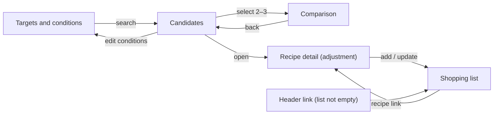

English | [日本語](../ja/UI_DESIGN.md) · [Docs index](README.md)

# UI Design — Recipe Discovery

This document describes the user interface of Recipe Discovery: views and flow, screen wireframes and states, navigation and state, styling, message catalogs, and input and adjustment details. It is for anyone who builds or reviews a screen. The UI changes no engine behavior: every value and status shown comes from `domain/nutrition` (ADR-028), `domain/recommendation` (ADR-029), and, for the shopping list, `domain/shopping`.

Status: **Accepted (owner, 2026-10-19, Stage 4.1)** for the MVP user interface (Phase 4). The shopping list (Phase 8, ADR-032, accepted 2026-10-25) adds §3.7. Decisions and their alternatives: [DECISIONS.md](../working/DECISIONS.md) ADR-030.

## 1. Principles

- The UI turns engine codes and numbers into localized texts and locale-formatted values. It never computes, adjusts, or re-rounds a nutrition value or a fit status.
- Numbers are formatted with `Intl` from the values of `roundForDisplay`; statuses come from the engine's full-precision fit ([NUTRITION_CALCULATION.md](NUTRITION_CALCULATION.md) §8).
- Targets, conditions, and session state stay in memory. They never appear in URLs or in `history.state`. Nothing except the locale preference is stored unless the user turns on saved conditions, which keeps the targets form on the device (ADR-015, ADR-030 D9, ADR-036).
- Every status has a text and a marker shape in addition to its color.
- Mobile first: one column below 768 px; wider layouts add columns but keep the same order of content for screen readers.

## 2. Views and flow



| View | URL | Content after reload |
|---|---|---|
| Targets and conditions | `/` | Preset defaults, or the saved conditions with a notice when saving is on (ADR-036) |
| Candidates | `/` (history entry with the view name only) | Targets view with the notice "Your conditions are not kept after reloading"; with saving on, the notice says only that search results and the shopping list are not kept |
| Comparison | `/` (history entry with the view name only) | Same as candidates |
| Recipe detail | `/recipes/<id>` | The recipe at its default amounts with no fit status; a link to the targets view |
| About | `/about` | The same page (it needs no search); reached from the footer |
| Shopping list | `/` (history entry with the view name only) | Targets view with the reload notice, which also says that the shopping list is not kept |

- The browser back button moves between views through history entries that carry only the view name and, for the detail view, the recipe ID.
- An unknown recipe ID shows a "recipe not found" state with a link to the targets view.
- Focus moves to the view's `h1` after each view change, and the document title includes the view name.

## 3. Screens (text wireframes)

### 3.1 Targets and conditions

Mobile (375 px):
```
┌─────────────────────────────────┐
│ Recipe Discovery   [Language ▾] │
├─────────────────────────────────┤
│ h1 Targets and conditions       │
│ Tagline        (hero art ≥ 640) │
│ (i) If you follow advice from a │
│     doctor or dietitian, …      │
│                                 │
│ ╭ panel: Example targets ─────╮ │
│ │ "Examples, not recommendations"│
│ │ ( ) Cut example 450–650 kcal │ │
│ │ (•) Maintain … (tinted card) │ │
│ │ ( ) Bulk …                   │ │
│ ╰─────────────────────────────╯ │
│ Max. cooking time [20] min [-][+]│
│                                 │
│ ╭ sky: > Describe in your own words╮
│ │ [text…]  [Read conditions]   │ │
│ ╰─────────────────────────────╯ │
│ ╭ panel: > More conditions ───╮ │
│ │ ◎ Targets per meal           │ │
│ │   Energy [450]–[650] kcal    │ │
│ │   Protein min. [35] g …      │ │
│ │   Servings [1] [-][+]        │ │
│ │ ◎ Cooking                    │ │
│ │   Effort · Cuisine · Equipment│ │
│ │ ◎ Foods                      │ │
│ │   Use these / Leave out chips│ │
│ │ ◎ Allergens                  │ │
│ │   (!) best effort …  [ ]egg …│ │
│ ╰─────────────────────────────╯ │
│ [(!) warning / (x) cannot search]│
│ ╭ butter: ◎ Save on this device╮ │
│ │ [ ] Save these targets and … │ │
│ │   [ ] Also save the allergens│ │
│ │ "Stays in this browser; …"   │ │
│ ╰─────────────────────────────╯ │
├─────────────────────────────────┤
│ [ ◎ Find recipes ] (sticky bar) │
└─────────────────────────────────┘
```
Desktop (≥ 1024 px): the same order in one column, with the hero illustration next to the heading and the groups inside "More conditions" in two or three columns; from 768 px the search button is a normal button below the form. Icons marked ◎ are the decorative two-tone icons of ADR-037.

States:
- Input errors (`InputError`) appear next to their field (`aria-describedby`) on blur and on submit; on submit, focus moves to an error summary that links to each field.
- A blocking contradiction disables nothing but stops the search and shows an alert with the numbers (for example "protein 60 g alone is about 240 kcal…"); a warning appears above the button and the search runs.
- Free-text conditions (ADR-034, revised again): a collapsible field below the time limit. "Read conditions" parses the text in the browser and shows what was read as a labelled list; nothing changes until "Apply", which adds foods and cuisines and replaces the time limit and equipment, then opens "More conditions" if it changed something there. A declined topic shows a message (allergens with a button that moves focus to the allergen choices); nothing recognized shows "no conditions found". Targets and allergens are never read. The result is announced in a polite live region.
- Saved conditions (ADR-036): a fieldset "Save on this device" above the search button. Its checkbox saves the form at once when turned on and deletes the record when turned off. While it is on, a second checkbox adds the allergen choices, and a "delete saved conditions" button deletes the record. A note says that the conditions stay in this browser, are sent nowhere, and can be seen by anyone who uses the browser. "Find recipes" saves the form as typed, before validation. After a reload, a restored record fills the form without searching, and a status at the top says so, with the number of items left out because the content no longer has them and its own delete button. "Deleted" and "could not be saved on this device" appear in a status inside the fieldset.
- Changing a preset overwrites the four target fields; editing a field afterwards keeps the chosen preset's label with "(edited)".
- Content loading and the content error with retry appear in place of the form.

### 3.2 Candidates

Mobile:
```
┌─────────────────────────────────┐
│ h1 Candidates (5)  [Edit conditions]│
│ Summary: 450–650 kcal, P ≥ 35 … │
├─────────────────────────────────┤
│ ╭ card (panel) ───────────────╮ │
│ │ [◎] h3 Lemon-herb chicken    │ │
│ │     ◷ 25 min · effort 2 · …  │ │
│ │ ✓ Meets all targets          │ │
│ │ Adjusted: chicken 120→160 g  │ │
│ │ ┌ butter ────┐ ┌ mint ──────┐│ │
│ │ │Energy      │ │Protein     ││ │
│ │ │520 kcal    │ │43 g        ││ │
│ │ │✓ in range  │ │✓ min. 35   ││ │
│ │ └────────────┘ └────────────┘│ │
│ │ ┌ peach ─────┐ ┌ sky ───────┐│ │
│ │ │Fat 8 g ✓   │ │Carb. 52 g  ││ │
│ │ └────────────┘ └────────────┘│ │
│ │ ( Lowest fat of these )      │ │
│ │ (i) includes approx. (!) allergens│
│ │ (Details) [☐ Compare] (Exclude)│
│ ╰─────────────────────────────╯ │
│ … more cards …                  │
│ [Show a different type]         │
│ [Compare (2)]  (sticky bar)     │
│                                 │
│ ── Close alternatives           │
│ card … fat 4 g over             │
│                                 │
│ ── If you relax a condition     │
│ Up to 30 min: +4 meet, +1 near  │
│ [Apply]                         │
│                                 │
│ Values are estimates …          │
└─────────────────────────────────┘
```
Desktop: cards in a grid of two or three columns; the comparison bar stays at the bottom. Each card shows the main protein group's icon and the four nutrients as labelled pastel tiles (ADR-037 D1); statuses keep their marker shapes and texts.

States:
- **Three to five candidates**: cards only.
- **Fewer than three**: the candidates, then a separated "close alternatives" section whose cards show the gaps (`near_target`, `misses_target`, `unknown_value`, `range_straddles`).
- **None**: a message, the exclusion counts per hard constraint ("time limit: 7 recipes"), and the relaxation options with their gains; plus the alternatives when the pool is not empty.
- **Exhausted** ("show a different type" finds no new recipe that meets the targets): the current set stays on screen with the notice "All recipes that meet your targets have been shown" and the actions "show close alternatives" and "change conditions" (ADR-030 D5).
- **Exclude this one**: the card is replaced in place; the others keep their position; focus moves to the new card's heading.
- Relaxation "apply" changes that one condition, runs the search again, and announces the new count in a live region.

### 3.3 Comparison

Mobile: a table with one column per recipe (2–3), horizontally scrollable within its own container with the nutrient names as sticky row headers; the page itself never scrolls horizontally.
```
┌─────────────────────────────────┐
│ h1 Compare       [Back]         │
│ ┌──────────┬────────┬────────┐  │
│ │          │ Recipe A│ Recipe B│ │
│ │ Time     │ 25 min │ 15 min │  │
│ │ Energy   │ 520 ✓  │ 610 ✓  │  │
│ │ Protein  │ 43 ✓   │ 36 ✓   │  │
│ │ Fat      │ 8 ✓    │ 14 ✓   │  │
│ │ Carb.    │ 52     │ 70     │  │
│ │ Adjusted │ yes    │ no     │  │
│ │ Approx.  │ yes    │ no     │  │
│ │          │[Details]│[Details]│ │
│ └──────────┴────────┴────────┘  │
└─────────────────────────────────┘
```
Desktop: the same table without horizontal scrolling.

### 3.4 Recipe detail and adjustment

Mobile:
```
┌─────────────────────────────────┐
│ h1 Recipe name    [Back]        │
│ 25 min · effort 2 · stove, pan  │
│ (!) Allergens: egg (contains) … │
├─────────────────────────────────┤
│ Per serving (estimates)         │
│ Energy 520 kcal ✓ (500–540)     │
│ Protein 43 g ✓                  │
│ Fat 8 g ✓ · Carbohydrate 52 g   │
│ Since last change: protein +8 g │
│ Status: fat near → met          │
├─────────────────────────────────┤
│ Adjust                          │
│ Servings [2] [-][+]             │
│ Chicken breast [160] g [-][+]   │
│ Eggs [2] [-][+]                 │
│ Side: rice [on/off]             │
│ Substitute: ( )none ( )thigh    │
│ [Fit to my targets] [Reset]     │
├─────────────────────────────────┤
│ Shopping list                   │
│ [Add to shopping list]          │
│ (after adding: In the list      │
│  (2 servings) · View the list;  │
│  [Update the list] [Remove] when│
│  the amounts differ)            │
├─────────────────────────────────┤
│ Ingredients (2 servings)        │
│ Chicken breast 320 g (2)        │
│   Food: young chicken breast,   │
│   skinless, raw · 11220 ·       │
│   raw value used (approx.)      │
│   protein … g / fat … g         │
│ …                               │
├─────────────────────────────────┤
│ Steps 1. … 2. … (amount notes)  │
│ Safety notes …                  │
├─────────────────────────────────┤
│ How this is calculated (toggle) │
│ Approximations, assumptions,    │
│ unknown values; energy note     │
│ Source: 日本食品標準成分表（八訂）│
│ 増補2023年から引用 + translation │
│ Data 2026-03-27 · content …     │
└─────────────────────────────────┘
```
Desktop: two columns; the nutrition summary and adjustment controls stay in a sticky right column while ingredients and steps scroll on the left.

States:
- Without a search (direct link or reload): default amounts, no fit statuses, no "fit to my targets".
- An invalid adjustment state cannot be reached through the controls (steppers follow the authored grid and bounds); engine errors are still mapped to messages.
- Unknown values show "unknown" with the ingredients that lack data, never zero.
- When a rounded value looks like it meets a bound that the full value misses, the value is shown to one decimal with "just below the target" (or "just above").
- Shopping list (ADR-032): a section of its own after the adjustment section, available with and without a search.
  - "Add to shopping list" copies the current state (servings, amounts, sides, substitutions) into the list.
  - Afterwards the block shows "In the shopping list (2 servings)" with a link to the list. When the current state differs from the list entry, it offers "Update the list" and "Remove from the list".
  - With 10 recipes in the list, the add button is disabled and the reason is shown.
  - Adding, updating, and removing are announced in the live region; focus stays on the block.

### 3.5 Shared elements

- Header: app name, a link to the shopping list with its recipe count, and the language switcher. The link appears only while the list has a recipe and may use a shorter label at narrow widths.
- Footer: attribution, content and composition versions, and a link to the about page.
- Comparison table (§3.3) and the ingredient table of the detail view (§3.4): the visible caption sits above the scrolling region and labels it. The table keeps a visually hidden `caption`, so the caption no longer scrolls with the table.
- The estimates disclaimer appears on candidates, comparison, and detail views. The allergen disclaimer appears wherever allergen features appear.
- A live region announces search results, replacements, and recalculations.

### 3.6 About

- `h1` "About this app" and a link to the targets view.
- Then sections with `h2` headings:
  - what the app does ("What this app does") and that it follows fixed rules without AI;
  - how nutrition values are calculated: estimates, cooked values and weight change rates, approximations and hard-to-estimate items, ranges, unmeasured values shown as unknown, strict-control note;
  - source and data versions (attribution as in the footer);
  - allergens: the allergen disclaimer, unknown treated as "may contain";
  - health: not medical advice, presets as examples, medical guidance;
  - what the app does not do;
  - privacy: no analytics, cookies, ads, or external requests; the language choice is stored, and the targets and conditions only when the user turns on saving (allergens only with their own checkbox); otherwise they stay in memory; they never enter the URL;
  - open-source licenses, with a link to `/third-party-licenses.txt`, generated by `build.license` (Vite).
- No contact address ([DECISIONS.md](../working/DECISIONS.md) "Stage 5.1 release plan" P7).

### 3.7 Shopping list

Rules for items, amounts, combination, sections, and order: [SPEC.md](SPEC.md) §18 and ADR-032. The view only renders what `domain/shopping` returns, with names from the active text bundle and numbers from `src/format/`.

Mobile:
```
┌─────────────────────────────────┐
│ h1 Shopping list      [Back]    │
│ From 2 recipes                  │
│ ┌ Lemon-herb chicken breast ──┐ │
│ │ 2 servings · amounts adjusted│ │
│ │                    [Remove] │ │
│ └─────────────────────────────┘ │
│ ┌ Tofu champuru ──────────────┐ │
│ │ 1 serving · 1 side off      │ │
│ │                    [Remove] │ │
│ └─────────────────────────────┘ │
│ [Copy as text] [Print] [Clear all]│
│ (i) Amounts are the edible      │
│ portion or the weight as sold.  │
├─────────────────────────────────┤
│ h2 Ingredients                  │
│ ☐ Chicken breast, skinless 300 g│
│   > Per recipe                  │
│ ☐ Egg 100 g (2)                 │
│ ☐ Cooked white rice 360 g       │
│ h2 Check whether you have       │
│ ☐ Soy sauce 18 g (1 tbsp)       │
│ ☐ Frying oil: vegetable oil 500 g│
│   The amount depends on the pan.│
└─────────────────────────────────┘
```
Desktop (≥ 1024 px): the recipes, actions, and note in a left column, the two sections on the right; the reading order stays the same.

- Recipes: the name links to its detail, which opens in the state of the list entry; the summary names the servings and the changes (amounts adjusted, sides switched off, substitutions). "Remove" takes the recipe out of the list.
- Items: a native checkbox whose label is the food name and amount; a checked item is struck through and keeps its place. An item from two or more recipes has a "Per recipe" disclosure (`details`) with each recipe's amount. Frying oil carries its note.
- Copy as text: the Clipboard API with the text below; the result is announced in the live region. If the API is missing or fails, a read-only text area with the whole text appears, selected, with an instruction to copy it by hand. When every item is checked, the button is disabled and the reason is shown.
- Print: `window.print()`; the print styles hide the header, the buttons, and the disclosures and print the title, the recipes with servings, the note, and every item with an empty box, whatever its check.
- Clear all: a second, inline confirmation ("Clear the list?" with "Clear" and "Cancel"); focus moves to the confirmation, then to the `h1`.
- Focus: after "Remove", focus moves to the next recipe's "Remove", else the previous one, else the `h1`. The live region announces removals and clearing.
- Empty: "No recipes yet. You can add them from a recipe's detail." with a link to the targets view.
- The view shows no nutrition values, allergen notices, or disclaimers of its own; the footer is unchanged.

Copied text (plain text, `\n` line breaks, `- ` bullets in every locale; numbers formatted with `Intl`; a section without unchecked items is left out; final wording in the Stage 8.3 review):
```
Shopping list (2 recipes)
- Lemon-herb grilled chicken breast (2 servings)
- Tofu champuru (1 serving)

[Ingredients]
- Chicken breast, skinless 300 g
- Egg 100 g (2)

[Check whether you have]
- Soy sauce 18 g (1 tbsp)
- Frying oil: vegetable oil 500 g

Amounts are the edible portion (without skin, bones, or shells) or the weight as sold.
```
Japanese and Spanish use the same structure, for example `買い物リスト（2品）`, `[手元にあるか確認するもの]`, `- 卵 100 g（2個）`, `- しょうゆ（濃口） 18 g（大さじ1）`; `Lista de la compra (2 recetas)`, `[Comprueba si ya lo tienes]`, `- Huevo 100 g (2)`, `- Salsa de soja 18 g (1 cucharada)`.

## 4. Navigation and state

- No router library (ADR-030 D2). `src/navigation/` wraps the History API with the views `targets`, `candidates`, `comparison`, `detail` (with a recipe ID), `about`, and `shoppingList`.
- Only the detail view (`/recipes/<id>`) and the about page (`/about`) have their own paths. The others use `/` with the view name in `history.state`.
- `popstate` restores the view. If the view needs a search that is no longer in memory, the targets view is shown with the notice.
- Application state lives in one `useReducer` behind a context (`src/state/`). No store library. The state holds:
  - the request, the evaluated pool, the session, the seed, the displayed set, and the comparison selection;
  - per-recipe adjustment states;
  - the shopping list: recipe IDs with their copied states in the order added, and the checked items;
  - the saved-conditions status: whether the stored record was read, saving on or off, allergens included or not, and the current notice. The record is read once after the content loads (`src/state/useRestoreSavedConditions.ts`); the targets view writes and deletes it (`src/state/savedConditions.ts`).
- A new search resets everything except the targets draft and the shopping list.
- The pool is recomputed only when the request changes. "Show a different type", "exclude this one", and comparison use `selectCandidates` on the same pool.
- The seed starts at 0 for every new search and increases by 1 for each "show a different type" (ADR-029 D6).
- The recommendation runs on the main thread. Phone-class timing is measured against a threshold of about 100 ms at a 4× CPU slowdown (ADR-030 D10, revised).
  - Release 7 with 130 recipes: about 54–59 ms median and 62–66 ms p90 ([DECISIONS.md](../working/DECISIONS.md) "Phase 10 acceptance").
  - Earlier: about 80 ms in Stage 5.4; about 50 ms after Phase 9 Stage 9.3.
- The solver results that do not depend on the targets are added to the engine data after the first view is shown.

## 5. Styling

- Tailwind CSS v4 through `@tailwindcss/vite`, with design tokens defined in CSS (`@theme`) (ADR-030 D3). No external fonts; system font stacks per script (Japanese and Latin).
- Breakpoints: base (mobile) and `md` 768 px, `lg` 1024 px.
- Color tokens meet WCAG 2.2 AA (4.5:1 for text, 3:1 for markers and focus rings) against their backgrounds; a test checks the token pairs because jsdom cannot compute contrast.
- Status markers: met ✓ (filled circle), near ◐ (half circle), not met ✕ (outlined), unknown ? (dashed); always with text.
- Visible focus ring on every interactive element; `prefers-reduced-motion` disables transitions.

### Visual identity (Phase 14)

The "soft pop" direction (ADR-037): the calm, warm base of a fresh market with pastel accents, two-tone icons, and colored tiles for the nutrition numbers. Stage 14.2 applied the tokens below, a 14 px default radius, and the base component utilities in `src/styles.css` (`btn-primary`, `btn-lg`, `btn-secondary`, `btn-outline`, `panel`, `notice-warning`, `chip`); `warning` and `warning-surface` remain as tokens equal to `near` and `peach`. Stage 14.3 added the icons and illustrations in `src/components/icons/`: the shapes are data (`iconData.ts`, `illustrationData.ts`), drawn by `Icon` and `Illustration` in `Icon.tsx`. Stage 14.4 applied the identity to every view: panels, two-tone icons, SVG status markers, colored nutrient tiles on candidate cards, illustrations, and the three layout changes. "More conditions" is grouped under targets per meal, cooking (effort, cuisines, equipment), foods, and allergens; the time limit stays outside as a quick input. The wireframes of §3 show the new layout (updated in Stage 14.5).

| Token | Light | Dark | Use |
|---|---|---|---|
| `bg` | `#FBF6EE` | `#191815` | Page background |
| `surface` | `#FFFFFF` | `#23211D` | Panels, cards, inputs |
| `surface-muted` | `#F1EADF` | `#2D2A25` | Unselected choices, collapsed sections |
| `text` | `#2A2722` | `#F2EDE4` | Body text, outlines of icons and illustrations |
| `muted` | `#5F584D` | `#C4BBAD` | Hints and secondary text |
| `border` | `#8A8174` | `#8F8678` | Input and button borders |
| `primary` | `#2E6B3A` | `#93D19A` | Main action, selected choice, brand |
| `on-primary` | `#FFFFFF` | `#13240F` | Text on `primary` |
| `accent` | `#C2452E` | `#FF9478` | Tomato coral: illustrations and small accents |
| `mint`, `butter`, `sky`, `peach` | `#E2F0DF`, `#FFEDB8`, `#DCEBFB`, `#FCE3DA` | `#1F3320`, `#3A3120`, `#1C2B3B`, `#3E2620` | Pastel fills: nutrient tiles, icon fills, notices, sections |
| `sun` | `#F2B33D` | `#F2B33D` | Decoration only; text on it uses `#2A2722` |
| `met`, `near`, `not-met` | `#23692E`, `#9A5300`, `#B3261E` | `#7FD48A`, `#F2B45C`, `#FF8F87` | Status texts and markers |
| `focus` | `#1E5FCC` | `#8AB4F8` | Focus ring |

- Contrast (checked 2026-11-01): text on `bg` 13.8:1 (light) and 15.2:1 (dark); `muted` on `surface-muted` 5.9:1 and 7.5:1; `on-primary` on `primary` 6.4:1 and 9.2:1; every status color on `surface` and on each pastel at least 4.75:1 (`near` on `peach`, light); `border` on `surface` 3.8:1 and 4.5:1; `focus` on `bg` 5.5:1 and 8.4:1. Pastels carry no meaning by themselves: nutrient tiles are told apart by their labels, and statuses keep their texts and marker shapes.
- Type: system fonts (no web font). Body 16 px with line height 1.6; hints 13–14 px; `h1` 32 px weight 900 with a short three-color bar below it; `h2` 22 px and `h3` 18 px weight 800; nutrition numbers 28 px weight 800 with `tabular-nums`.
- Shape: inputs and small tiles 14–16 px radius; panels and cards 24 px; buttons and chips fully rounded. Panels and cards have a soft shadow in light mode; the main action has a solid 5 px shadow in the text color that shrinks when pressed.
- Icons: original two-tone SVG on a 24 px grid, 1.8 px round strokes in `currentColor` with pastel fills; decorative ones are `aria-hidden`, meaningful ones have a label from the catalogs; no text inside. Set: protein groups (chicken, pork, beef, fish, egg, soy), equipment (`EQUIPMENT`), time, effort, servings, actions (search, save, delete, compare, shopping list, copy, print, back, language, close), notices (warning, information), and the four status markers redrawn with their current shapes. No icons for cuisines, nutrients, or allergens.
- Illustrations: next to the targets heading (smaller or hidden on phones), in the empty and exceptional states (no candidates, empty shopping list, recipe not found, content error), and next to the about heading. Decorative, without text.
- Motion: a small press on buttons and a short fade when cards appear; none with `prefers-reduced-motion`.
- Layout changes: "More conditions" opens when restored saved values are inside it; the targets form is grouped under the headings targets, time and effort, foods, and allergens; on phones, "Find recipes" stays at the bottom of the screen. The flow of views does not change.

## 6. Catalog structure

`ja` defines the type; `en`, `es`, and `fr` must match (`src/i18n/messages/`). New namespaces:

| Namespace | Keys |
|---|---|
| `nav` | View names, back links, reload notice, not-found |
| `saved` | The save switch, the allergen checkbox, the shared-browser note, the delete button, and the restored, dropped, deleted, and write-failed notices |
| `targets` | Preset names and "example" labels, fields, units, help, the medical guidance notice, the search button, error summary |
| `conditions` | Time, effort levels, cuisines (`CUISINES`), equipment (`EQUIPMENT`) and equipment modes, required and excluded foods, food groups, autocomplete states (no match = "not supported") |
| `inputError` | One key per `InputError` code, with the field names and limits as values |
| `contradiction` | `minimum_energy_exceeds_kcal_max` blocking and warning |
| `status` | `met`, `near`, `not_met`, `unknown`, target-less, "just below/above the target" |
| `reason` | One key per `ReasonData` code, with targets and attributes as sub-keys |
| `exclusion` | One key per `ConstraintItem`, with plural counts |
| `relaxation` | One key per `Relaxation` constraint, with gains as plural counts |
| `candidates`, `comparison`, `detail`, `adjust` | View texts, adjustment summary, differences, status changes |
| `shopping` | Header link, detail block, view texts, recipe summaries, section names, frying oil label and note, edible portion note, copy, print, and clear texts, announcements, the copied text's title and section labels, empty state |
| `nutrient` | Display names of the five nutrients and their units |
| `uncertainty` | Classes and reasons (`raw_value_for_cooking`, `related_cooked_value`, `post_cooking_refuse`, `fried`, `slow_frying`, `estimated_source_value`), notations (trace, estimated) |
| `assumption` | `oil_counted_in_full`, `included_in_cooked_value`, `parts_removed_after_cooking`, `energy_from_fat`, `pinch_as_stated_grams`, energy versus 4P + 9F + 4C |
| `unit` | Household units (`HOUSEHOLD_UNITS`) with plural forms; `piece` shows the number alone in `en`, `es`, and `fr` (ADR-026); grams, kcal, minutes |
| `allergen` | Names of all `ALLERGENS` (glossary terms) and the confidence levels |
| `disclaimer` | Estimates, allergens, strict control (P4: weigh and check labels) |
| `attribution` | The MEXT wording in Japanese in every locale, followed by the localized equivalent, the data version, and "this app's own calculations" |

- Counts use i18next plural suffixes (`_one`, `_other`). Every locale defines both keys because `ja` defines the catalog type; Japanese plural rules select `_other` only, so both hold the same Japanese text. French plural rules also put 0 and 1.5 in `_one`; household units pass only 1 or 2 as the count, so they need no other form.
- Household units choose the singular up to one unit ("1/2 clove", "1 1/2 cloves"); quantities are shown as fractions of twelfths ("1/2", "1 1/2"; Japanese "1と1/2", Spanish "1 y 1/2", French "1 et 1/2").
- A test requires a key for every engine code (input errors, contradictions, statuses, reasons, constraint items, relaxations, uncertainty reasons, assumptions, units, allergens, cuisines, equipment) in each locale.
- The forbidden-expression check of `content/glossary.ts` is extended to the UI catalogs.

## 7. Input details

- Number fields: `<input type="text" inputmode="numeric">` with a visible unit, steppers (buttons with labels such as "increase protein minimum"), and values validated by `validatePoolRequest` with `INPUT_LIMITS` (unchanged, ADR-030 D4). Empty optional fields mean "no target".
- Ingredient autocomplete: the ARIA 1.2 combobox pattern over the food dictionary of the active text bundle. Normalization: `ja` NFKC and katakana-to-hiragana folding; `en` case folding; `es` case and accent folding; `fr` case and accent folding, with `œ`/`æ` as `oe`/`ae`. Matches names and aliases (ADR-030 D6). Results list the food's display name; no match shows "not supported".
- Food groups: the protein groups (`PROTEIN_GROUPS`) are offered as "chicken (any cut)" and so on. A group as a required item is one any-of item; a group as an exclusion adds every food of the group.
- Equipment: "no limit" (default), "microwave only", or "choose" with checkboxes (ADR-030 D7).

## 8. Adjustment details

- Servings stepper (1–20), steppers on the authored grid for grams and whole units, side switches, substitution radio buttons from the recipe's list, "fit to my targets" (applies the solver state of the pool entry; without a search it is hidden), and "reset to default".
- Every change recalculates with `calculateNutrition` and shows the difference from the previous state as the difference of the displayed (rounded) values, for example "protein +8 g, energy +60 kcal", and each status change (ADR-030 D8).
- Side steps are hidden when the side is off; amount notes appear from `atLeastGrams`; safety notes follow substitutions.
- A scaled count that is fractional is shown with one decimal in the ingredient list (ADR-028 F).
