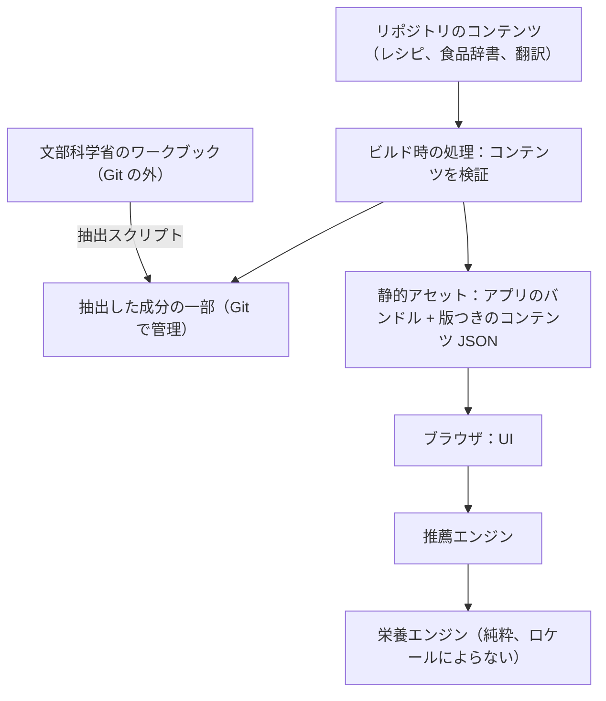
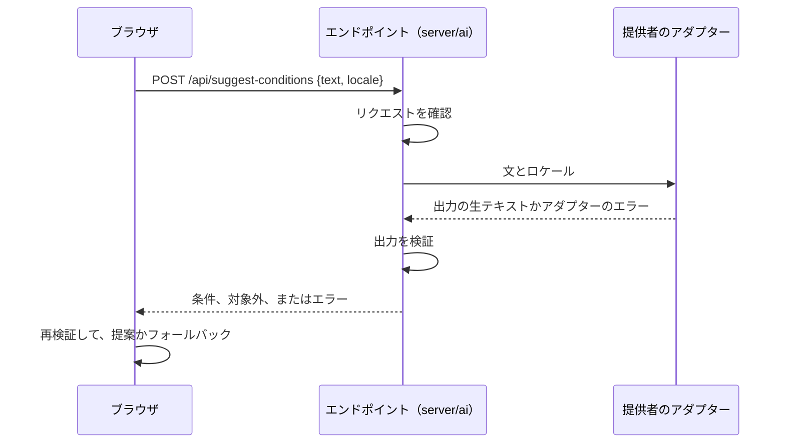

<!-- source: docs/en/ARCHITECTURE.md blob e931bbef556e1bba7e60338a142d85450d245064 -->
[English](../en/ARCHITECTURE.md) | 日本語 · [目次に戻る](README.md)

> この文書は[英語版](../en/ARCHITECTURE.md)の翻訳。内容が異なる場合は英語版が優先する。

# アーキテクチャ — Recipe Discovery

Recipe Discovery の作りを説明する。レイヤーとその境界、データモデル、多言語対応、ビルド時の処理、ブラウザでの推薦の流れ、プラットフォームからの独立、セキュリティ、テストを扱う。コードやコンテンツを変える開発者に向けている。コマンドと今のディレクトリ構成は [DEVELOPMENT.md](DEVELOPMENT.md) にある。

状態：**運用中**。2026-10-18 に作成し、フェーズ 0〜10 で実装した。決定は [DECISIONS.md](../working/DECISIONS.md)（英語のみ）に記録している（ADR-001〜ADR-014 と、それ以降の ADR）。

## 1. 概要

MVP は**静的なシングルページアプリケーション**だ。コンテンツはすべてビルド時に用意し、計算はすべてブラウザで行う。

- ビルド時の処理では、スキーマ、ロケールのそろい具合、食品の対応、アレルゲン、ポリシーの lint を確かめ、栄養の回帰スナップショットを保つ（§5）。
- MVP には、アプリケーションサーバー、データベース、管理画面、AI はない（ADR-002、ADR-004）。
- ホスティングは Cloudflare の静的アセットだ。プラットフォーム固有の設定は切り離す（ADR-001）。

## 2. レイヤーと責務

| レイヤー | 責務 | 依存してはならないもの |
|---|---|---|
| `domain/nutrition` | レシピの状態（人数、副菜、連動する材料、選んだ置き換え）に対する分量の決定、材料ごと・レシピごとの栄養、調理の状態の扱い、不確かさの区分、範囲、表示する値の丸め（ADR-028） | UI、i18n、ロケール、プラットフォーム、ネットワーク |
| `domain/recommendation` | ハードな絞り込み、適合の評価、適合の段階、多様化、シードつきの再提案、範囲内での調整ソルバー、置き換えの提案、緩和の提案、矛盾の確認 | UI、i18n、ロケール、プラットフォーム、ネットワーク |
| `domain/shopping` | 買い物リストの集計（ADR-032）：`domain/nutrition` の `resolveAmounts` を使ったレシピの状態からの品目、食品 ID でのまとめ、欄、並び順、揚げ油、家庭での計量の合計。栄養値は扱わない | UI、i18n、ロケール、プラットフォーム、ネットワーク |
| `shared` | ビルドツール、ドメイン、UI が使うコンテンツのスキーマと型、ID、単位、定数。任意の AI エンドポイントの HTTP の契約と出力の検証（`shared/suggestion.ts`、§7） | UI、プラットフォーム |
| `server/ai` | 任意の AI エンドポイントの、プラットフォームによらない中核（ADR-034）：リクエストの確認、タイムアウトつきの提供者の呼び出し、出力の検証、エラーの応答。提供者のアダプターの interface と、テスト用の fake アダプター | UI、ドメイン、コンテンツ、プラットフォーム |
| `content/`（データ） | レシピ、食品辞書、アレルゲンの結び付け、置き換え、多言語のテキスト、用語集 | — |
| `tools/`（ビルド時） | 成分の抽出、コンテンツ検証、ポリシーの lint、栄養のスナップショット、ヘッダーの生成 | UI |
| `src/`（UI） | React アプリ、ナビゲーション、i18n、書式、状態、アクセシビリティ（[UI_DESIGN.md](UI_DESIGN.md)） | プラットフォーム固有の API |
| `platform/` | ホスティングの設定（Cloudflare）と生成するセキュリティヘッダー | ドメインのロジック |

この境界は、オーナーのほかのプロジェクトと同じく、lint の import 制限と境界のテストで守る。ディレクトリ構成は [DEVELOPMENT.md](DEVELOPMENT.md)「構成（現在）」にある。

## 3. データモデル（概略）

スキーマは `shared/content.ts` にある（ADR-026）。計算のルールは [NUTRITION_CALCULATION.md](NUTRITION_CALCULATION.md) にある。

- **Food**：ロケールによらない `id`（変わらないスラッグ）、`composition` の参照（調理の状態ごとの食品番号とデータの版。`raw` や `grilled` など）、調理方法ごとの重量変化率、廃棄率、確からしさつきのアレルゲンの結び付け（`contains`、`may_contain`、`unknown`）、すべてのロケール（`ja`・`en`・`es`・`fr`）の `names` と検索用の `aliases`。
- **Recipe**：`id`、時間、手間、料理の種類、目標、主なたんぱく源の群、タグ、器具、人数、材料、副菜、キーつきの手順と食品安全の注記、置き換え、多言語のテキスト。「時短」と「揚げ物」は導出する。
- **RecipeIngredient**：食品 ID、生の可食部のグラム数、調理の状態と方法、家庭での計量（単位と量）、役割、調整の範囲（グラムか個数）、`linkedTo` で示す連動元、推定困難の印。
- **Side**：多言語のラベル、材料、「目標に合わせる」がオフにしてよいかどうか。
- **Substitution**：置き換え元と置き換え先の食品、比率、任意の範囲、差し替える手順のテキストと安全の注記。
- **成分の一部**：食品番号ごとに、選んだ栄養素の値と表記の印（`measured`、`estimated`、`trace`、`zero`、`unmeasured`）、元データの版、チェックサムのマニフェスト。

## 4. 多言語対応

- ライブラリは、型つきの TypeScript メッセージカタログを使う i18next だ。オーナーがほかでも使っている方法だ（ADR-005）。
- UI のカタログ：`ja` がメッセージの型を決め、`en`、`es`、`fr` はコンパイル時にその型と一致しなければならない。
- コンテンツ：すべてのレシピと食品に `ja`、`en`、`es`、`fr` のテキストを持たせる。欠けていたり空だったりするとビルドが失敗する。
- **食品の同一性と翻訳は切り離す**（ADR-006）。材料はロケールによらない食品 ID を参照し、名前と別名は表示と検索のためだけのデータだ。栄養の関数はロケールの引数を受け取らず、型でそれを強制する。
- ロケールごとの検索の正規化：
  - `ja`：Unicode NFKC と、ひらがな・カタカナの同一視。検索語の長音記号は、それが伸ばす母音にも一致し、オ段とエ段のかなの後では「う」や「い」にも一致する。
  - `en`：大文字・小文字の同一視。
  - `es`：大文字・小文字とアクセントの同一視。
  - `fr`：大文字・小文字とアクセントの同一視。`œ` と `æ` は `oe` と `ae` として扱う。
  - 別名で地域ごとの言い方を補う（`patata` / `papa` など）。
- 家庭での計量の単位は、ロケールごとの表示ラベルだ（大さじ / tbsp / cucharada）。分量はグラムで保存し、大さじ 1 は 15 mL と定める。
- 書式には `Intl` の API を使い、値の書式化は表示の層でだけ行う。
- ロケールの判定と保存（オーナーのほかのアプリと同じ方式、`src/i18n/localePreference.ts`）：保存したロケールの設定が有効ならそれを使う。なければ `navigator.languages` のうち最初に対応している言語、それもなければ `ja` にする。保存するのはロケールの設定だけだ。

## 5. ビルド時の処理

1. **抽出**：スクリプトが `data/raw/`（Git の管理外）から文部科学省のワークブックを読み、その SHA-256 をマニフェストと照らし合わせる。食品辞書が参照する食品番号と、選んだ列だけを、表記の印とともに書き出す。出力とマニフェストは Git で管理する（[DATA_SOURCES.md](DATA_SOURCES.md)）。
2. **コンテンツ検証**：スキーマ、ID の重複がないこと、すべての材料が食品に、すべての食品が成分データに対応すること、ロケールのそろい具合、調整の範囲の正しさ、置き換えの正しさ、アレルゲンの結び付けがあること（または明示的に `unknown` であること）を確かめる。
3. **ポリシーの lint**：すべてのロケールで、禁止している健康や効能の表現を探す（[CONTENT_POLICY.md](CONTENT_POLICY.md)）。
4. **栄養のスナップショット**：レシピごとの計算値をテストのスナップショットとして保存する。データや式を変えると、確認できる差分が出る。
5. **コンテンツのバンドル**（ADR-027）：`tools/build-content.ts` が、ロケールによらない計算用のバンドルと、ロケールごとのテキストのバンドルを `generated/content/`（Git の管理外）に書き出す。Vite が各ファイル名に内容のハッシュを付ける。
6. **ヘッダーの生成**：セキュリティヘッダーは 1 か所で定め、ホスティング先の形式で書き出す。

## 6. 推薦の流れ（ブラウザ）

1. 計算用のバンドルと、今のロケールのテキストのバンドル（静的、内容のハッシュつき）を読み込む（`src/content/`）。`zod/mini` で検証し、互いの整合も確かめる。バンドルに届かないか不正なときは、再試行の操作つきのエラー状態を出す。ロケールを切り替えると、言語が変わる前にそのテキストのバンドルだけを読み込むので、画面はマウントされたままになる。
2. 利用者の入力を検証し、矛盾する目標を見つける（`src/views/TargetsView.tsx` と `domain/recommendation`）。
3. ハードな絞り込み → 適合の評価（既定の分量、次に範囲内での調整）→ 適合の段階 → 多様化 → 安定した並べ替え、をメインスレッドで行う（ADR-030 D10）。目標によらないソルバーの結果は、最初の画面を出したあとに計算用のバンドルごとに 1 回だけ求める（`src/state/providers.tsx`、`domain/recommendation/data.ts` の `withPrecomputed`）。その結果があってもなくても、検索の結果は同じだ。
4. 候補と決定論的な理由のテキストを、型つきのカタログから描く（`src/views/candidates/`）。
5. 詳細画面では調整のたびに再計算する（`src/views/DetailView.tsx`）。時間は次の一覧にまとめた。
6. 状態はメモリに保つ（`src/state/`、ADR-015、ADR-030 D9）。専用の URL を持つのはレシピの詳細と「このアプリについて」のページだけだ（`src/navigation/`、ADR-030 D2）。
7. 買い物リスト（ADR-032）は、利用者が追加したレシピの状態をメモリに保つ。`domain/shopping` が集計するのはリストが変わったときと表示するときだけで、推薦の最中には集計しない。

ブラウザで測った時間：
- デスクトップ（Stage 4.7）：推薦全体は UI の中で約 25 ms。再提案は約 2 ms、再計算は約 3 ms（クリックからレイアウトまで）。
- CPU 4 倍の遅さ、130 レシピのリリース 7：推薦全体は中央値で約 54〜59 ms、p90 で 62〜66 ms（[DECISIONS.md](../working/DECISIONS.md)（英語のみ）"Phase 10 acceptance"）。ADR-030 D10（改訂後）の 100 ms のしきい値に収まっている。
- 以前の 4 倍での値：Stage 6.2 の 60 レシピで 66 ms、Stage 9.3 の前は約 80〜88 ms、Stage 9.3 の後は約 50 ms。

## 7. プラットフォームからの独立

- 本番の出力は、ふつうの静的ビルド（`dist/`）だ。Cloudflare 固有なのは `platform/cloudflare/` と生成したヘッダーのファイルだけだ。
- ドメイン、コンテンツ、UI のコードは Cloudflare の実行時 API を使わない。テストは Node で動く。
- 静的なアプリに Worker はいらない。サーバーの機能は HTTP の契約を `shared/` に定め、提供者ごとの実装を薄いアダプターに閉じ込める。任意の AI エンドポイント（ADR-034）もこれに従う。契約は `shared/suggestion.ts`、プラットフォームによらない中核とアダプターの interface は `server/ai/` に置き、Cloudflare 固有になるのは `platform/cloudflare/` の薄いラッパーだけだ。実際の提供者のアダプター、Worker、ラッパーはまだない（ステージ 12.3 と 12.5）。
- デプロイ手順（[DEPLOYMENT.md](DEPLOYMENT.md)）では、Cloudflare（`platform/cloudflare/wrangler.jsonc`）と、同じ `dist/` をほかの静的ホストで配信する方法を説明している。`/assets/` の下のハッシュつきファイルには、生成した `_headers` で 1 年間の immutable なキャッシュのルールを付ける。

### AI による自由入力の条件の契約

エンドポイントは、利用者が自分の言葉で書いた文から検索条件の提案を作る。利用者は提案を適用するか破棄し、適用した条件だけが決定論的なエンジンに渡る（ADR-034 D1、D6）。出力はすべてエンドポイントで検証し、ブラウザでもう一度検証する。どこかで失敗したら、フォームは変わらない。

- **リクエスト**：`POST /api/suggest-conditions` に JSON `{ "text": string, "locale": "ja" | "en" | "es" | "fr" }` を送る。文は前後の空白を除いて 1〜200 個の Unicode コードポイント。ほかのフィールドがあれば拒否するので、目標、フォームの条件、アレルゲン、履歴は送れない。
- **成功（200）**：`{ "kind": "conditions", "conditions": … }` か `{ "kind": "out_of_scope", "topic": "allergens" | "targets" | "other" }`。条件の形はエンジンの `Conditions` と同じで、`requiredFoods`（食品 ID 5 個までの「どれか一つ」の組を 5 組まで）、`excludedFoods`（食品 ID 10 個まで）、省略できる `maxMinutes`（5〜240 の整数。エンジンの入力の上下限）、省略できる `equipment`（利用者が持っている調理器具）、`cuisines` からなる。自由なテキストのフィールドはない。
- **エラー**：`{ "kind": "error", "error": code }`。

| コード | ステータス | 起きるとき |
|---|---|---|
| `invalid_request` | 400 | リクエストがスキーマに合わない。提供者は呼ばない |
| `disabled` | 503 | 環境変数のスイッチが切れている（ADR-034 D5）。ブラウザは 404 も同じに扱う |
| `rate_limited` | 429 | エンドポイントか提供者のレート制限 |
| `budget_spent` | 503 | 提供者の利用額の上限に達した |
| `timeout` | 504 | 提供者が 7 秒以内に答えない |
| `refused` | 502 | 提供者がリクエストを断った |
| `invalid_output` | 502 | 出力が検証を通らない |
| `unavailable` | 502 | 提供者のそのほかの失敗 |

- **出力の検証**（`validateProviderOutput`）は次の順に進む。4,000 文字以内か。リクエストのロケールによらず、4 つのロケールすべてで `content/glossary.ts` の禁止表現がないか。JSON として読めるか。禁止した語幹（目標、栄養素、アレルゲン、健康、火力、調理時間、自由なテキスト）を含むキーがないか。厳格なスキーマ（許したフィールドと列挙値だけ、長さの上限）に合うか。食品 ID がすべて辞書にあるか。同じ食品が必須と除外の両方にないか。重複は取り除く。中核は数えたり評価したりするために拒否の理由を返すが、文そのものは返さない。
- **フォールバック**（ブラウザの `interpretResponse`）：応答を同じ規則でもう一度検証する。提案なら確認のために表示する。対象外のリクエストには `ai.outOfScope.<topic>` を出す（アレルゲンならアレルゲン欄への案内）。失敗はすべて `ai.error.<code>` を出す。ブラウザだけで起きる `offline`、8 秒でのブラウザのタイムアウト、条件が一つもない提案の `empty` も含む。カタログの文言は UI と一緒に加える（ステージ 12.4）。
- **アダプター**：`SuggestionAdapter.suggest(request, signal)` は、提供者の出力の生テキストを返すか、`rate_limited`、`budget_spent`、`timeout`、`refused`、`unavailable` のどれかを持つ `AdapterError` を投げる。中核はこれをタイムアウトと競わせるので、中断のシグナルを無視するアダプターでもタイムアウトする。テストは `server/ai/fake.ts` を使い、ネットワークには出ない。

## 8. セキュリティとプライバシー

- 厳格な Content-Security-Policy（`'self'` のみ）、`X-Content-Type-Options: nosniff`、`Referrer-Policy`、制限の強い `Permissions-Policy`、`frame-ancestors 'none'`。
- 実行時にサードパーティのスクリプト、フォント、画像を使わない。
- 任意の AI の機能を使わなければ、利用者のデータはブラウザの外に出ない。利用者が AI の提案を求めたときは、自由入力の文とロケールだけを送る（ADR-015 改訂）。リクエストのスキーマはほかのフィールドをすべて拒否する。目標と条件は URL に入れない。
- AI エンドポイントの中核は何もログに残さず、リクエストの文を返すことも記録することもない。AI の出力には栄養値、アレルゲン、健康に関する記述、加熱の温度や時間、自由なテキストが入らず、エンドポイントとブラウザの両方で検証する（§7）。
- 依存パッケージのインストールスクリプトは、許可リストの方針で管理する（フェーズ 0）。

## 9. テストの方針

- 栄養エンジンと推薦エンジンの単体テスト：決定論性、丸め、不確かさ、調整の範囲、多様性、緩和の提案、矛盾。
- 買い物リストの集計の単体テスト：まとめ方、人数による増減、副菜、置き換え、並び順、決定論性、ロケールによらないこと。
- **ロケール不変性のテスト**：どのロケールの文脈で計算しても、すべてのレシピの内部の値が同じになる。
- コンテンツ検証とポリシーの lint は、CI とビルドで動く。
- 栄養のスナップショットのテスト。
- jsdom による UI テスト：フィクスチャを使う `src/**/*.test.tsx` と、リポジトリのコンテンツを使う `test/ui/`。
- アクセシビリティの確認（axe-core、コントラストのルールは除く）を、すべての画面と例外的な状態について、すべてのロケールで行う。コントラストは色のトークンに対するテストで確かめる（`test/node/styles.test.ts`）。
- 本番ビルドとそのヘッダーに対する E2E テスト（`e2e/`、Playwright）：
  - ブラウザ：デスクトップの Chromium と、375 px の Chromium と WebKit。すべてのロケールで動かす。
  - 範囲：フロー全体、例外的な状態、ロケールの切り替え、ディープリンク、「このアプリについて」のページ、キーボード操作、ライトとダークでの色のコントラストを含む axe-core、セキュリティヘッダー、ほかのオリジンへのリクエストがないこと、CSP 違反がないこと。
- スマートフォン相当の時間の計測は必要なときに実行する（`npm run test:e2e:timing`）。

## 10. MVP に含まないもの

D1 などのデータベース、管理画面と認証、アプリケーションサーバー、AI の提供者、アクセス解析。これらがないのは意図したものだ（ADR-002、ADR-004、ADR-015）。
