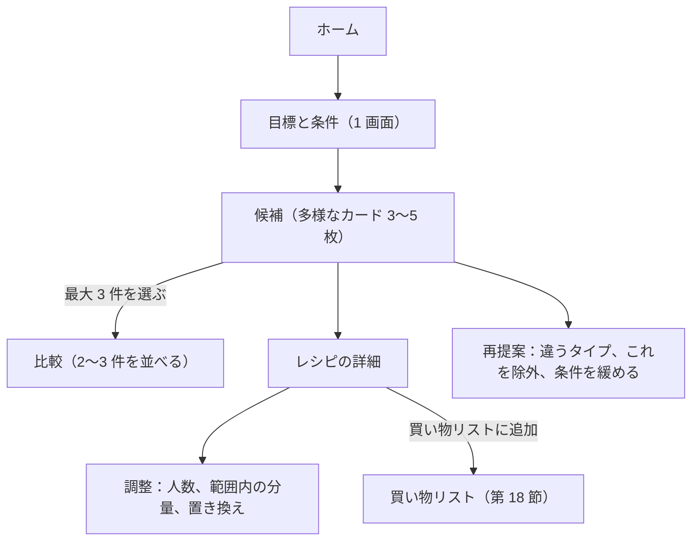

<!-- source: docs/en/SPEC.md blob 860d3916ce493e1d8202f9ba6062f3c75ec6b67d -->
[English](../en/SPEC.md) | 日本語 · [目次に戻る](README.md)

> この文書は[英語版](../en/SPEC.md)の翻訳。内容が異なる場合は英語版が優先する。

# プロダクト仕様 — Recipe Discovery

Recipe Discovery が利用者に何をするかを定める仕様だ。プロダクトの目的、対象ユーザー、範囲、ユーザーフロー、入力、順位付け、表示、受け入れ基準を扱う。プロダクトの動作を決めたり確かめたりする人に向けている。計算のルール、コンテンツのルール、画面の設計はそれぞれ別の文書にあり、各節からリンクしている。

状態：**運用中**。2026-10-18 に作成し、フェーズ 0 の仮の値はすべて決まった（第 16 節）。決定とその状態は [DECISIONS.md](../working/DECISIONS.md)（英語のみ）に記録している。

## 1. プロダクトの目的

栄養を意識する利用者が、栄養の目標と実際の条件に合い、しかも自分では思いつかない料理を見つけられるようにする。多様な候補をいくつか示し、それぞれが目標にどう合うかを説明し、比べて調整して選べるようにすることで、料理のレパートリーを広げる。

AI のレシピ生成ツールではない。レシピは厳選した構造化コンテンツだ。栄養値は食品成分のデータと明示した分量から決定論的に計算する。

中心となる価値：
- 高たんぱく、低脂質、カロリーの範囲といった栄養の目標を支える。
- 栄養は食品成分のデータと記載した分量から計算する。AI の自己申告は使わない。
- 調理時間、手間、好み、除外するもの、任意で必ず使う材料を考慮する。
- 多様な候補を示し、それぞれを選んだ理由と目標への合い方を説明する。
- 不確かな値や食品の対応を、正確なものとして示さない。
- アレルゲンの絞り込みの限界をはっきり示し、アレルゲンについての安全は保証しない。

## 2. 対象ユーザーとシナリオ

| ペルソナ | シナリオ | よくある条件 |
|---|---|---|
| P1 減量期の会社員（主な対象） | 平日の夕食。いつもの鶏肉とブロッコリーではない、新しいものがほしい | 1 食あたり約 500〜650 kcal、たんぱく質 ≥ 35 g、脂質 ≤ 15 g、≤ 20 分 |
| P2 増量期の学生 | 手間が少なく、満腹になる高たんぱくの食事 | 約 800 kcal、たんぱく質 ≥ 45 g、手間が少ない |
| P3 作り置きをする人 | 週末に数人分を作る | 複数人分、保存の注記に関心がある |
| P4 大会前に厳しく減量する人（注意） | 脂質とカロリーを厳しく管理する | アプリの推定値では精度が足りないことがある。厳しい管理には計量と製品表示の確認が必要だと UI で伝える |

対象外は、医療で指示された食事療法をしている人だ（腎臓病のたんぱく質制限、糖尿病の管理など）。目標の設定画面には、医師や管理栄養士の指導を受けている人はその指導に従うよう案内を出す。

## 3. 範囲

### MVP / P0
- 1 食あたりの栄養の目標：プリセット（減量／維持／増量）と独自の値。
- 条件：最大の時間、手間、料理の種類やスタイルの好み、除外する材料、アレルゲンの除外（できる範囲での対応）、器具、任意で必ず使う材料。
- 1 回の検索で多様な候補を 3〜5 件。2〜3 件を並べて比べられる。
- レシピの詳細：分量つきの材料、手順、栄養の内訳、計算の根拠、不確かさ、食品安全の注記、出典表示。
- 人数の変更、範囲内での分量調整、あらかじめ決めた置き換え、即時の再計算。
- 再提案：「違うタイプを見る」「これを除外」、候補が少ないときの条件緩和の提案。
- UI とすべてのコンテンツで日本語、英語、スペイン語。言語の切り替えは見える場所に置く。フランス語はフェーズ 11 で加えた（ADR-033）。
- 例外的な状態の UX（第 12 節）。

### MVP の後に加えたもの
- 買い物リスト（フェーズ 8、ADR-032）：第 18 節。
- 任意の自由文の条件化（フェーズ 12、ADR-034。リリース 9 で公開）：利用者が自分の言葉で希望を書くと、アプリが決まったルールで文から条件を読み取って示し、利用者が適用するか破棄するかを選ぶ。AI は使わない。目標、アレルゲン、すべての計算は決定的なままで、この機能がなくてもアプリはすべて動く。
- 目標と条件の保存（フェーズ 13、ADR-036。計画中で未公開）：利用者が目標の画面で保存をオンにすると、フォームの内容をこの端末のブラウザに残し、次に開いたときにフォームへ戻す。検索は自動では始めない。アレルゲンの選択は別のチェックボックスを選んだときだけ保存する。保存は既定でオフで、オフにするか削除の操作をすると保存した内容を消す。

### MVP の範囲外
- ユーザーアカウント、サーバー側の保存、日単位や週単位の献立。
- 実行時の AI（レシピの生成、AI による説明、AI による置き換えの提案、AI による自由文の読み取り）。
- 包装された製品の栄養（バーコード、Open Food Facts）、価格、外部サービスとの連携、アクセス解析。
- プロジェクトが所有するオリジナル以外の写真（MVP では写真の予定はない）。
- 地域ごとの材料の入手しやすさ（手に入りにくい材料に注記を付けるだけ）。

## 4. ユーザーフロー

- 目標と条件の画面には、簡単な入力（目標のプリセット、最大の時間）と、折りたためる詳細の入力がある。詳細では kcal、たんぱく質、脂質、炭水化物の値、手間、好み、除外、アレルゲン、器具、必ず使う材料を指定できる。
- 調整するとすぐに再計算し、差分を示す。
- 買い物リストでは、品目のチェック、リストのコピー、印刷ができる。
- フローの状態はメモリに保つ。目標と条件は URL に入れないので、体に関わる目標が履歴やリファラーに残らない。
- MVP では、ロケールの設定以外はブラウザに何も保存しない（第 16 節、ADR-030 D9）。買い物リストもメモリにとどめる（第 18 節）。

## 5. 入力

| 入力 | 既定値 | 必須 | 種類 |
|---|---|---|---|
| 目標のプリセット（減量／維持／増量） | 維持 | はい（プリセットが値を埋める） | 以下の値を埋める |
| 1 食あたりのカロリー（範囲） | プリセットから | はい | ソフト（順位の段階） |
| たんぱく質の下限 | プリセットから | 任意 | ソフト（順位の段階） |
| 脂質の上限 | プリセットから | 任意 | ソフト（順位の段階） |
| 炭水化物の範囲 | なし | 任意 | ソフト（順位の段階） |
| 人数 | 1 | はい | 計算の基準 |
| 最大の調理時間 | なし | 任意 | **ハード** |
| 手間（3 段階） | なし | 任意 | ソフト |
| 料理の種類やスタイルの好み | なし | 任意 | ソフト |
| 除外する材料 | なし | 任意 | **ハード** |
| アレルゲンの除外 | なし | 任意 | **ハード、できる範囲での対応**（[CONTENT_POLICY.md](CONTENT_POLICY.md)） |
| 器具（電子レンジのみ など） | なし | 任意 | **ハード** |
| 必ず使う材料（「使いたい材料」） | なし | 任意 | **ハード**（レシピはそのすべてを含む） |

- 栄養の目標はハードな絞り込みにしない。推定の誤差のせいで境界付近のレシピが消え、結果が空になりやすいからだ。代わりに適合の段階を使う（第 6 節）。
- プリセットの値は例であって、助言ではない。体重などの個人データから目標を計算することはしない。
- 材料の入力（必ず使う材料、除外する材料）は、ロケールに応じた入力補完で食品辞書から選ぶ。そのため、対応していない材料は入力できない。検索には各ロケールの名前と別名を使う（[ARCHITECTURE.md](ARCHITECTURE.md)「多言語対応」）。
- 入力の検証で、検索の前に矛盾する目標を見つける（第 12 節）。

## 6. 順位付け、多様性、再提案

1. ハードな制約を適用する。
2. 残った各レシピの目標への適合を、既定の分量で評価する。許される場合は、範囲内で分量を調整したうえでも評価する（第 8 節）。
3. レシピを適合の段階に分ける：すべての目標を達成、一部の目標が近い（許容幅内）、一部の目標が未達成。
4. 得られる中でいちばんよい段階から、決定論的な多様化の手順で候補を選ぶ。主なたんぱく源、料理の種類、調理方法がばらつくようにする。それでも同点なら、好みのスコア、分量の変化の小ささ、シードつきの順序の順に比べ、最後はレシピ ID で決める。
5. 「違うタイプを見る」は、同じ候補の集まりから、シードつきの再現できる順序で次の多様な組を選ぶ。そのセッションですでに示した候補は除く。

詳しくは ADR にある：
- 許容幅：ADR-025。
- ADR-029：範囲を使った適合の評価、段階、ソルバーの目的関数、多様化（導出した調理方法の系統を使う）、重みのない辞書式のキーとしての好み、シードつきの順序、ハードな絞り込み、緩和、矛盾の確認。

## 7. 候補のカードとレシピの詳細

候補のカード：
- レシピ名、時間、手間。
- 1 人前の kcal／たんぱく質／脂質／炭水化物。それぞれを目標の帯と比べ、判定（達成、近い、未達成）とともに示す。元の値が未測定なら不明とする。
- 分量を調整したときは「調整済み」のバッジと調整の要約（「鶏むね肉 120 g → 160 g」など）。
- 決定論的な 1 行の理由（「たんぱく質の目標を達成し、これらの候補の中で脂質がいちばん少ない」など）。
- 推定に近似が含まれるときは不確かさのバッジ。関係するときはアレルゲンの案内。
- 利用者が必ず使う材料を指定したときは、使われているその材料。

レシピの詳細：
- グラム数と、作成した家庭での計量つきの材料。それぞれに食品の対応（食品名、食品番号、生か調理後か）を添える。
- 材料ごとと 1 人前の栄養、その合計。
- 不確かさの詳細（近似、仮定、微量の値）。
- 手順、食品安全の注記、置き換え、調整の操作。
- 出典表示：「日本食品標準成分表（八訂）増補2023年から引用」、値はこのアプリが独自に計算した推定値だという記述、データの版。
- 注意書き：推定値にすぎないこと、アレルゲンの絞り込みは保証ではないこと。

## 8. 調整、置き換え、再計算

- 再計算はすべてブラウザで決定論的な関数によって行い、すぐに反映する。前の状態からの差分（「たんぱく質 +8 g、脂質 +3 g」など）と判定の変化を示す。
- 人数を変えると、すべての材料の分量が変わる。
- 範囲内での調整：変えてよい材料、その最小値と最大値、刻み、連動する材料をレシピごとに定める（調味料は主材料に合わせて増減する、など）。個数単位は守る（卵は 1 個単位、など）。手順には、しきい値を超えたときに出す注記を定められる（「大きめのフライパンを使う」など）。
- 「目標に合わせる」は MVP に含む（ADR-024）。主なたんぱく源と炭水化物の分量を範囲内で選び、既定の分量からの変化がいちばん小さく、目標を満たすものにする。
- 副菜（ご飯、じゃがいも、野菜の付け合わせ）はオンとオフを切り替えられる。ソルバーがオフにできるのは炭水化物の副菜だけだ。オンのままの副菜は、作成した最小の分量以上を保つ（ADR-026）。
- 置き換えは、レシピごとにあらかじめ決めた一覧からだけ選べる。置き換えると、関係する注記や時間が変わることがある。

## 9. 栄養の表示と不確かさ

ルールは [NUTRITION_CALCULATION.md](NUTRITION_CALCULATION.md) にある。利用者から見た動作：
- 値には推定値であることを示す。
- 各材料の寄与、食品番号、データの版、調理の状態が見える。
- 不確かさの区分：
  - 完全一致。
  - 近似：類似食品、調理する材料に生の値や関連する調理後の値を使う場合、成分表に揚げた形がある揚げ物。
  - 推定困難：多量の油での低温揚げ、成分表に揚げた形がない揚げ物。
- 「ひとつまみ」のような家庭での計量は表示の補助だ。計算には記載したグラム数を使う。
- 近似は説明し、大きな不確かさは範囲で示す。
- 値の範囲が目標の境界をまたぐときは、判定を「近い／不確か」とし、「達成」にはしない。
- エネルギーは成分表の値を使うので、4P + 9F + 4C と一致しないことがある。詳細画面でその理由を説明する。

## 10. 多言語対応

- ロケールは `ja`、`en`、`es`、`fr`（`fr` はフェーズ 11 から。ADR-033）。既定値と判定の方法は [ARCHITECTURE.md](ARCHITECTURE.md)「多言語対応」に従う。
- 多言語化するもの：UI の文字列、レシピ名、材料の表示名と検索用の別名、手順、注記、置き換え、検証とエラーのメッセージ、アクセシビリティのラベル、文書の言語のメタデータ。
- 公開するレシピと食品は、すべてのロケールでコンテンツがそろっていなければならず、欠けているとビルドが失敗する。そのため、公開するコンテンツに実行時の代替表示はいらない。
- 数値と単位はロケールごとの書式で表示する（スペイン語とフランス語では小数点にコンマを使う、など）。元の値は変わらない。
- 計算した栄養値は、どのロケールでも同じだ。

## 11. アレルゲン、食品安全、健康に関する表現

ルールは [CONTENT_POLICY.md](CONTENT_POLICY.md) にある。要約：
- アレルゲンの除外はできる範囲での対応だ。アレルゲン情報が不明な材料は「含む可能性あり」として扱う。レシピがアレルギーのある人にとって安全だとは決して言わない。
- すべてのレシピに、関係する食品安全の注記を入れる（肉に中まで火を通す、熱い油の扱い、など）。
- 健康、医療、効能の主張はしない。

## 12. 例外的な状態

| 状況 | 動作 |
|---|---|
| 候補がない | ハードな制約ごとに除外したレシピの数と、決定論的な緩和の選択肢を、その結果の件数とともに示す（「30 分まで許す：+4 件」など） |
| 候補が 3 件未満 | 候補を示し、そのあとにはっきり分けて「近い候補」を、達成していない目標とともに示す（「脂質が 4 g 超過」など） |
| 矛盾する目標 | 検索の前に見つけて説明する（たんぱく質の下限だけでエネルギーがカロリーの上限に近づく場合、など） |
| 必ず使う材料のせいでレシピが少なすぎる | 候補がない・少ない場合と同じ。「この必ず使う材料を外す：+N」も含む |
| ある材料のアレルゲン情報が不明 | アレルゲンの絞り込みが有効なときは除外し、理由を示す |
| コンテンツの読み込みに失敗 | 再試行の操作（コンテンツは静的なので、まれなはず） |
| 対応していない材料 | 辞書による入力では起こらない。一致するものがないと、入力補完が「対応していません」と示す |

## 13. プライバシーとセキュリティ

- MVP にはアカウントもサーバー側の保存もなく、アプリケーションサーバーもない。
- 目標と条件はブラウザの中にとどまり、URL には入れない。
- 保存した条件（ADR-036）は、利用者が保存をオンにしたときだけ、端末の `localStorage` に 1 件のレコードとして残す。送信もしないし Cookie にも入れない。同じブラウザを使う人なら誰でも見られることは UI で伝える。アレルゲンの選択には別のチェックボックスが要る。保存しない場合、残すのは言語の設定だけだ。
- 買い物リストはメモリにとどめる。コピーと印刷は利用者が始めるブラウザの機能で、何も送信しない（第 18 節）。
- 既定ではアクセス解析もトラッカーもない。
- すべてのレスポンスに厳格なセキュリティヘッダー（Content-Security-Policy と関連するヘッダー）を付ける。
- 将来サーバーのエンドポイントを設けるなら、実行時に入力と出力を検証し、利用者の目標や条件をログに残してはならない。
- 自由文の条件化（フェーズ 12、ADR-034）は、ブラウザの中で文を読み取る。入力した文はどこにも送らず、保存もしない。

## 14. アクセシビリティと UX

- モバイルとデスクトップに対応するレスポンシブなレイアウト。モバイル優先。
- セマンティックな HTML、キーボード操作、見えるフォーカス、ラベル付きの操作部品、正しい `lang` 属性。
- 比較や栄養のバーは色だけに頼らない。値は常にテキストでも読める。
- 動きを減らす設定に対応する。
- アクセシビリティの確認はすべてのロケールで行う。

## 15. MVP の受け入れ基準

- フロー全体（目標 → 条件 → 候補 → 比較 → 詳細 → 調整 → 再提案）が、AI なしでモバイルとデスクトップで動く。
- 同じ入力とデータからは、常に同じ候補、順序、栄養値が出る。
- 同じレシピと分量なら、内部の栄養値はどのロケールでも同じ。
- UI の文字列と公開するコンテンツのすべてが、すべてのロケールでそろっている（ビルド時に確認）。
- すべての栄養値を、食品番号、データの版、調理の状態、仮定までたどれる。
- 元データの未測定の値を 0 として扱わない。近似と推定困難な項目を常に示す。
- アレルゲンの絞り込みが有効なとき、該当する材料や不明な材料を含むレシピを除外し、注意書きを常に表示する。
- どのコンテンツにも健康や効能の主張がない（コンテンツ検証）。
- 成分表への出典表示を示す。
- lint、型チェック、単体テスト、コンテンツ検証、E2E テスト、すべてのロケールでのアクセシビリティの確認、本番ビルドが通る。

## 16. 決定した値

フェーズ 0 では仮の値だったが、今はすべて決まっている。

| 項目 | 値 | 決定した段階 |
|---|---|---|
| 適合の許容幅 | ±10%（たんぱく質は下限より 3 g 下まで）（ADR-025） | フェーズ 0 |
| 表示の丸め | kcal は 10 単位、たんぱく質／脂質／炭水化物は 1 g 単位。判定は完全な精度の値から（ADR-025） | フェーズ 0 |
| 範囲の表示のルール | 材料ごとに理由に応じた誤差幅を付け、表示単位の 2 倍より広いときに範囲を示す（ADR-025） | フェーズ 0 |
| レシピライブラリの規模 | MVP では約 60 件、構成のルールつき（ADR-023）。約 86 件（フェーズ 7）、約 130 件（フェーズ 10）に改訂 | フェーズ 0。フェーズ 7 と 10 で改訂 |
| 分量調整の範囲 | 主なたんぱく源と炭水化物のみ。オフにできる副菜つき（ADR-024、フェーズ 1 で改訂） | フェーズ 0 |
| 目標と閲覧したレシピのブラウザでの保存 | MVP では保存しない。ロケールの設定だけを保存する（ADR-030） | フェーズ 4 |
| プリセットの値 | 減量 450〜650 kcal / P ≥ 35 g / F ≤ 15 g、維持 550〜750 / ≥ 30 / ≤ 20、増量 750〜950 / ≥ 45 / ≤ 30（ADR-025） | フェーズ 0 |

## 17. 未解決の質問（要確認）

[DECISIONS.md](../working/DECISIONS.md)（英語のみ）の "Open questions" で管理している。

## 18. 買い物リスト（フェーズ 8）

買い物リストは、利用者が選んだ状態の 1 つ以上のレシピを、買うものの 1 つのリストにまとめる。価格、店、包装の大きさ、在庫の管理、献立は扱わない。決定と検討した案は [DECISIONS.md](../working/DECISIONS.md)（英語のみ）の ADR-032 に、画面とテキストの形式は [UI_DESIGN.md](UI_DESIGN.md) §3.7 にある。

### レシピの追加

- レシピはレシピの詳細からだけ追加できる。「買い物リストに追加」は、そのレシピの今の状態をリストに写す。写すのは人数、調整した分量、副菜のオンとオフ、置き換えだ。
- 1 レシピにつき 1 件で、最大 10 レシピまで入る。同じレシピを 2 回作るなら、人数を増やす。
- あとで詳細の状態がリストの内容と違ってきたら、詳細画面に「リストを更新」と「リストから外す」を出す。リストがひとりでに変わることはない。
- 出どころ：リストには各レシピの名前（詳細へのリンク）、人数、変更の要約（分量の調整、オフにした副菜、置き換え）を示す。品目ごとに、レシピ別の分量も見られる。

### 分量

- 分量は、レシピの状態に対して `domain/nutrition` が求めるグラム数（`resolveAmounts`）で、詳細画面と同じだ。
- オフにした副菜は何も加えない。置き換えた材料は置き換え先の食品として載せる。
- ほかの材料の調理後の値に含めて数える材料（調理用の油、衣）も、調理に必要なので載せる。
- リストは栄養値を示さず、計算もしない。
- 基準：グラム数は生の可食部（皮、骨、殻を除く）か、市販の状態の重さ（`as_is` の食品）で、リストにもそう書く。廃棄率から求める購入量は示さない。

### 品目のまとめ方

- 品目は食品 ID でまとめる。どの食品も 1 つの基準だけで使う。常に市販の状態か、常に生の可食部だ。
- 買い方の違う形は別の食品として扱う（ご飯と乾燥パスタ、トマトとトマト缶）。そのため、調理の状態で品目が分かれることはない。
- 揚げ油（揚げた材料や低温で揚げた材料に含めて数える油）は別の品目にする。ほかの用途の同じ油とは足さず、量は鍋で変わると添える。
- 合計は完全な精度で計算し、表示するときだけ丸める。詳細画面の材料のグラム数と同じく、小数第 1 位までだ。
- 家庭での計量の合計を示すのは、すべての出どころに同じ単位の家庭での計量があり、その和が 1/12 の倍数のときだけだ。単位は換算しない。

### 欄と並び順

- 欄は「食材」と「手元にあるか確認するもの」の 2 つ。後者には材料の役割が `seasoning` と `fat` のものを入れる。リストの中でほかの役割も持つ食品は「食材」に入れる。
- 欄の中では、決まった役割の順に並べる：主なたんぱく源、主な炭水化物、野菜、その他と衣。調味料、油、揚げ油。
- 次に、最初に出てきた順に並べる。レシピは追加した順、材料は作成した順だ。
- 並び順はロケールによらない。

### リストの使い方

- チェック：すべての品目にチェックボックスがある。品目の合計が変わると、そのチェックは外れる。
- 出力：テキストでのコピー（チェックしていない品目）と印刷（すべての品目を空の四角つきで）。共有サービスは使わない。
- 保存：リストはセッションの間メモリに保つ。画面の移動、新しい検索、言語の切り替えでは消えない。言語を切り替えると名前と単位は新しい言語で示し、分量は変わらない。再読み込みで消える。ブラウザには何も保存しない（第 13 節、ADR-015、ADR-030 D9）。
- 安全：リストは栄養値を示さず、アレルゲン、食品安全、健康について独自の記述をしない。

### 受け入れ基準（フェーズ 8）

- 集計は純粋で決定論的な、ロケールによらないモジュールだ。単体テストと、リポジトリのレシピの代表的な組み合わせに対するスナップショットで確かめている。
- 利用者が `ja`、`en`、`es` で、デスクトップとモバイルで、詳細画面からレシピを追加し、品目をチェックし、リストをコピーし、印刷できる。新しい文字列は 3 つのロケールで確認し、アクセシビリティの確認も 3 つのロケールで通る。
- 栄養のスナップショットと推薦のシナリオのスナップショットが変わらない。推薦全体が CPU 4 倍の遅さで約 100 ms 以内に収まる（ADR-030 D10）。
