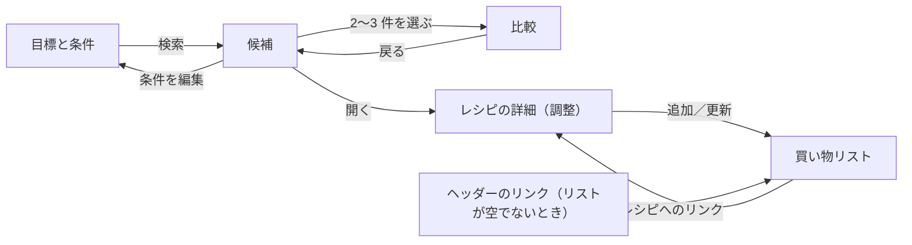

<!-- source: docs/en/UI_DESIGN.md blob 14ee50bb3154a8257489708149e90483eb21b6b6 -->
[English](../en/UI_DESIGN.md) | 日本語 · [目次に戻る](README.md)

> この文書は[英語版](../en/UI_DESIGN.md)の翻訳。内容が異なる場合は英語版が優先する。

# UI 設計 — Recipe Discovery

Recipe Discovery のユーザーインターフェースを説明する。画面とフロー、画面のワイヤーフレームと状態、ナビゲーションと状態、スタイル、メッセージカタログ、入力と調整の詳細を扱う。画面を作る人や確認する人に向けている。UI はエンジンの動作を何も変えない。表示する値と判定はすべて `domain/nutrition`（ADR-028）、`domain/recommendation`（ADR-029）、買い物リストでは `domain/shopping` から来る。

状態：MVP のユーザーインターフェース（フェーズ 4）について**採用（オーナー、2026-10-19、Stage 4.1）**。買い物リスト（フェーズ 8、ADR-032、2026-10-25 採用）で §3.7 を加えた。決定とその代替案は [DECISIONS.md](../working/DECISIONS.md)（英語のみ）の ADR-030 にある。

この翻訳では、画面の図（テキストのワイヤーフレーム）を英語のまま残している。罫線の桁をそろえるためだ。図や本文の中の UI の文言は英語の UI を示したもので、日本語の UI の実際の文言は `src/i18n/messages/` のカタログにある。

## 1. 原則

- UI は、エンジンのコードと数値を、多言語のテキストとロケールに応じた書式の値に変える。栄養値や適合の判定を、計算したり、調整したり、丸め直したりはしない。
- 数値は `roundForDisplay` の値から `Intl` で書式化する。判定は、エンジンが完全な精度で求めた適合から来る（[NUTRITION_CALCULATION.md](NUTRITION_CALCULATION.md) §8）。
- 目標、条件、セッションの状態はメモリに保つ。URL にも `history.state` にも入れない。利用者が条件の保存をオンにしたときだけ、目標のフォームを端末に残す。それ以外にはロケールの設定しか保存しない（ADR-015、ADR-030 D9、ADR-036）。
- どの判定にも、色に加えてテキストと印の形を付ける。
- モバイル優先：768 px 未満は 1 列にする。それより広いレイアウトでは列を増やすが、スクリーンリーダー向けのコンテンツの順序は変えない。

## 2. 画面とフロー



| 画面 | URL | 再読み込み後の内容 |
|---|---|---|
| 目標と条件 | `/` | プリセットの既定値。保存がオンなら、保存した条件を案内つきで復元する（ADR-036） |
| 候補 | `/`（画面名だけを持つ履歴の項目） | 目標の画面と、「再読み込みすると条件は保持されません」という案内。保存がオンなら、案内は検索結果と買い物リストが残らないことだけを伝える |
| 比較 | `/`（画面名だけを持つ履歴の項目） | 候補と同じ |
| レシピの詳細 | `/recipes/<id>` | 既定の分量で、適合の判定なしのレシピ。目標の画面へのリンク |
| このアプリについて | `/about` | 同じページ（検索を必要としない）。フッターから開く |
| 買い物リスト | `/`（画面名だけを持つ履歴の項目） | 再読み込みの案内つきの目標の画面。案内では、買い物リストも残らないことを伝える |

- ブラウザの戻るボタンでは、画面名と、詳細画面ならレシピ ID だけを持つ履歴の項目をたどって画面を移る。
- 存在しないレシピ ID では「レシピが見つかりません」の状態を、目標の画面へのリンクとともに示す。
- 画面が変わるたびに、フォーカスはその画面の `h1` に移り、文書のタイトルに画面名が入る。

## 3. 画面（テキストのワイヤーフレーム）

### 3.1 目標と条件

モバイル（375 px）：
```
┌─────────────────────────────────┐
│ Recipe Discovery   [Language ▾] │
├─────────────────────────────────┤
│ h1 Targets and conditions       │
│ Tagline        (hero art ≥ 640) │
│ (i) If you follow advice from a │
│     doctor or dietitian, …      │
│                                 │
│ ╭ panel: Example targets ─────╮ │
│ │ "Examples, not recommendations"│
│ │ ( ) Cut example 450–650 kcal │ │
│ │ (•) Maintain … (tinted card) │ │
│ │ ( ) Bulk …                   │ │
│ ╰─────────────────────────────╯ │
│ Max. cooking time [20] min [-][+]│
│                                 │
│ ╭ sky: > Describe in your own words╮
│ │ [text…]  [Read conditions]   │ │
│ ╰─────────────────────────────╯ │
│ ╭ panel: > More conditions ───╮ │
│ │ ◎ Targets per meal           │ │
│ │   Energy [450]–[650] kcal    │ │
│ │   Protein min. [35] g …      │ │
│ │   Servings [1] [-][+]        │ │
│ │ ◎ Cooking                    │ │
│ │   Effort · Cuisine · Equipment│ │
│ │ ◎ Foods                      │ │
│ │   Use these / Leave out chips│ │
│ │ ◎ Allergens                  │ │
│ │   (!) best effort …  [ ]egg …│ │
│ ╰─────────────────────────────╯ │
│ [(!) warning / (x) cannot search]│
│ ╭ butter: ◎ Save on this device╮ │
│ │ [ ] Save these targets and … │ │
│ │   [ ] Also save the allergens│ │
│ │ "Stays in this browser; …"   │ │
│ ╰─────────────────────────────╯ │
├─────────────────────────────────┤
│ [ ◎ Find recipes ] (sticky bar) │
└─────────────────────────────────┘
```
デスクトップ（≥ 1024 px）：同じ順序で 1 列に並べ、見出しの横にイラストを置く。「詳細な条件」の中のグループは 2 列か 3 列にする。768 px 以上では、検索ボタンはフォームの下の普通のボタンになる。◎ は ADR-037 の飾りの 2 色アイコンを表す。

状態：
- 入力エラー（`InputError`）は、フォーカスが外れたときと送信したときに、その欄の横に出す（`aria-describedby`）。送信したときは、各欄へのリンクを持つエラーの要約にフォーカスが移る。
- 検索を止める矛盾では、何も無効にしないが検索を止め、数値つきの警告を出す（「たんぱく質 60 g だけで約 240 kcal…」など）。注意の場合はボタンの上に出し、検索は実行する。
- 条件の保存（ADR-036）：検索ボタンの上に「この端末に保存」の欄を置く。チェックボックスをオンにするとすぐにフォームを保存し、オフにするとレコードを消す。オンの間は、アレルゲンの選択も加える 2 つ目のチェックボックスと、レコードを消す「保存した条件を削除」ボタンを出す。注意書きで、条件はこのブラウザにだけ残り、どこにも送らず、このブラウザを使う人なら誰でも見られることを伝える。「レシピを探す」を押すと、検証の前に入力どおりのフォームを保存する。再読み込みの後は、保存したレコードでフォームを埋め、検索はしない。画面の上部の status でそのことを伝え、コンテンツから消えたため外した項目の数と、専用の削除ボタンを添える。「削除しました」と「この端末に保存できませんでした」は、欄の中の status に出す。
- 自由文の条件化（ADR-034 再改訂）：時間の上限の下に、折りたためる入力欄を置く。「条件を読み取る」を押すと、ブラウザの中で文を読み取り、読み取った内容をラベルつきの一覧で示す。「条件に反映する」を押すまでフォームは変わらない。反映すると、食材とジャンルを加え、時間の上限と設備を置き換える。「詳細な条件」の中が変わったときは、その欄を開く。断る話題はメッセージで示し、アレルゲンのときはアレルゲンの選択へフォーカスを移すボタンを添える。何も読み取れないときは「条件が見つからない」と示す。目標とアレルゲンは読み取らない。結果は polite のライブリージョンで読み上げる。
- プリセットを変えると、目標の 4 つの欄を上書きする。そのあと欄を編集すると、選んだプリセットのラベルに「（編集済み）」を付けて残す。
- コンテンツの読み込み中と、再試行つきのコンテンツのエラーは、フォームの代わりに出す。

### 3.2 候補

モバイル：
```
┌─────────────────────────────────┐
│ h1 Candidates (5)  [Edit conditions]│
│ Summary: 450–650 kcal, P ≥ 35 … │
├─────────────────────────────────┤
│ ╭ card (panel) ───────────────╮ │
│ │ [◎] h3 Lemon-herb chicken    │ │
│ │     ◷ 25 min · effort 2 · …  │ │
│ │     (★ New to you)           │ │
│ │ ✓ Meets all targets          │ │
│ │ Adjusted: chicken 120→160 g  │ │
│ │ Energy             520 kcal  │ │
│ │ [····(▓▓▓─●▓▓)·····]         │ │
│ │ ✓ in range  target 450–650   │ │
│ │ Protein               43 g   │ │
│ │ [··········(▓▓●▓▓▓▓▓]        │ │
│ │ ✓ in range  min. 35 g        │ │
│ │ Fat 8 g … · Carb. 52 g …     │ │
│ │ ( Lowest fat of these )      │ │
│ │ (i) includes approx. (!) allergens│
│ │ (Details) [☐ Compare] (Exclude)│
│ ╰─────────────────────────────╯ │
│ … more cards …                  │
│ [Show a different type]         │
│ [Compare (2)]  (sticky bar)     │
│                                 │
│ ── Close alternatives           │
│ card … fat 4 g over             │
│                                 │
│ ── If you relax a condition     │
│ Up to 30 min: +4 meet, +1 near  │
│ [Apply]                         │
│                                 │
│ Values are estimates …          │
└─────────────────────────────────┘
```
デスクトップ：カードを 2 列か 3 列のグリッドに並べる。比較のバーは下に固定したままにする。各カードには主なたんぱく源のアイコンを付け、4 つの栄養素をラベルつきの行で示す（ステージ 18.3、ADR-041 D4）。1 行目にラベルと値を並べ、目標があればバーを引き、その下に判定、目標または「目標なし」、推定の幅を置く。判定は今までどおり印の形とテキストで示す。

- **栄養のバー**：目標の帯を栄養素のパステル（エネルギーはバター、たんぱく質はミント、脂質はライラック、炭水化物はスカイ）で塗り、ユーザーが決めた側の端に `muted` の縁を付ける。推定の幅は、表示するときだけ線で示す。値は点で示す。目盛りは 0 から、値・推定の幅・目標のうち最大の数の 1.25 倍まで（`src/views/nutritionBar.ts`）。バーは表示している数から描くので、「目標をわずかに下回る」値は帯の左に来る。バーは飾りで（`aria-hidden`）、強制カラーと印刷では出さない。目標がないときと値が不明なときは描かない。
- **「はじめて表示」**：このページの前のセットで出ていない候補に、時間の行の下に太陽色のチップを付ける。ページで最初のセットには付けない。表示したレシピの一覧はメモリーにだけ置き（`src/state/reducer.ts` の `seen`）、新しい検索では残り、再読み込みで消える。

状態：
- **候補が 3〜5 件**：カードだけ。
- **3 件未満**：候補のあとに、分けて「近い候補」の欄を置き、そのカードで差を示す（`near_target`、`misses_target`、`unknown_value`、`range_straddles`）。
- **なし**：メッセージ、ハードな制約ごとの除外件数（「時間の上限：7 件」）、得られる件数つきの緩和の選択肢。候補の集まりが空でなければ、近い候補も示す。
- **出し尽くした**（「違うタイプを見る」で、目標を満たす新しいレシピが見つからない）：今の組を画面に残したまま「目標を満たすレシピはすべて表示しました」と案内し、「近い候補を見る」と「条件を変える」の操作を示す（ADR-030 D5）。
- **これを除外**：そのカードをその場で入れ替え、ほかのカードは位置を保つ。フォーカスは新しいカードの見出しに移る。
- 緩和の「適用」は、その 1 つの条件を変えて検索をやり直し、新しい件数をライブリージョンで読み上げる。

### 3.3 比較

モバイル：レシピごとに 1 列（2〜3 列）の表にする。表は自分のコンテナの中で横にスクロールでき、栄養素の名前は固定の行見出しにする。ページ自体は横にスクロールしない。
```
┌─────────────────────────────────┐
│ h1 Compare       [Back]         │
│ ┌──────────┬────────┬────────┐  │
│ │          │ Recipe A│ Recipe B│ │
│ │ Time     │ 25 min │ 15 min │  │
│ │ Energy   │ 520 ✓  │ 610 ✓  │  │
│ │ Protein  │ 43 ✓   │ 36 ✓   │  │
│ │ Fat      │ 8 ✓    │ 14 ✓   │  │
│ │ Carb.    │ 52     │ 70     │  │
│ │ Adjusted │ yes    │ no     │  │
│ │ Approx.  │ yes    │ no     │  │
│ │          │[Details]│[Details]│ │
│ └──────────┴────────┴────────┘  │
└─────────────────────────────────┘
```
デスクトップ：同じ表を、横スクロールなしで示す。

### 3.4 レシピの詳細と調整

モバイル：
```
┌─────────────────────────────────┐
│ h1 Recipe name    [Back]        │
│ 25 min · effort 2 · stove, pan  │
│ (!) Allergens: egg (contains) … │
├─────────────────────────────────┤
│ Per serving (estimates)         │
│ Energy                 520 kcal │
│ [······(▓▓─●▓▓▓)······]         │
│ ✓ in range  target …  500–540   │
│ Protein 43 g … Fat 8 g …        │
│ Carbs 52 g  Salt 1.8 g          │
│ Since last change: protein +8 g │
│ Status: fat near → met          │
├─────────────────────────────────┤
│ Adjust                          │
│ Servings [2] [-][+]             │
│ Chicken breast [160] g [-][+]   │
│ Eggs [2] [-][+]                 │
│ Side: rice [on/off]             │
│ Substitute: ( )none ( )thigh    │
│ [Fit to my targets] [Reset]     │
├─────────────────────────────────┤
│ Shopping list                   │
│ [Add to shopping list]          │
│ (after adding: In the list      │
│  (2 servings) · View the list;  │
│  [Update the list] [Remove] when│
│  the amounts differ)            │
├─────────────────────────────────┤
│ Ingredients (2 servings)        │
│ Chicken breast 320 g (2)        │
│   Food: young chicken breast,   │
│   skinless, raw · 11220 ·       │
│   raw value used (approx.)      │
│   protein … g / fat … g         │
│ …                               │
├─────────────────────────────────┤
│ Steps 1. … 2. … (amount notes)  │
│ Safety notes …                  │
├─────────────────────────────────┤
│ How this is calculated (toggle) │
│ Approximations, assumptions,    │
│ unknown values; energy note     │
│ Source: 日本食品標準成分表（八訂）│
│ 増補2023年から引用 + translation │
│ Data 2026-03-27 · content …     │
└─────────────────────────────────┘
```
デスクトップ（ステージ 18.3、ADR-041 D4）：`lg` 以上では、栄養の欄を最大 22 rem の右の列に移し、ウィンドウの高さが 48 rem 以上ならスクロール中もヘッダーの下に固定する。アレルゲンのお知らせ、調整、買い物リスト、材料、手順、安全上の注意、計算の根拠は左の列に置くので、ステッパーを操作しながら値を見られる。DOM の順序はモバイルと同じだ。固定するのは栄養の欄だけにした。調整の欄まで固定すると、逆方向にフォーカスを移したときにステッパーが栄養の欄の下に隠れる（WCAG 2.4.11）。材料の表は幅が狭くなり、1024〜1280 px では領域の中で横にスクロールする。

状態：
- 検索をしていないとき（直接のリンクや再読み込み）：既定の分量で、適合の判定も「目標に合わせる」もない。
- 正しくない調整の状態には、操作部品からはたどり着けない（ステッパーは作成した刻みと範囲に従う）。それでも、エンジンのエラーはメッセージに対応付ける。
- 栄養の行（ステージ 18.3、ステージ 16.3 のタイルを置き換え）：候補のカードと同じく栄養素ごとに 1 行で示し、値は 24 px にする。各行には、値、目標があればバー、判定の印と文言、目標または「目標なし」、推定の幅を入れる。栄養素を示すのは色ではなくラベルだ。食塩相当量には目標がなく、バーもない。変化の要約には透明の枠線を付け、強制カラーでも縁が見えるようにする。
- 不明な値は、データのない材料とともにその行で「不明」と示し、0 にはせず、バーも描かない。
- 丸めた値では上下限を満たすように見えても、完全な値では満たさないことがある。そのときは値を小数第 1 位まで示し、「目標をわずかに下回る」（または「目標をわずかに上回る」）と添える。
- 買い物リスト（ADR-032）：調整の欄のすぐ後の独立した欄で、検索の有無にかかわらず使える。
  - 「買い物リストに追加」は、今の状態（人数、分量、副菜、置き換え）をリストに写す。
  - そのあとは「買い物リストに入っています（2人分）」とリストへのリンクを示す。今の状態がリストの内容と違うときは「リストを更新」と「リストから外す」を出す。
  - リストに 10 レシピあるときは、追加のボタンを使えなくし、その理由を示す。
  - 追加、更新、削除はライブリージョンで読み上げ、フォーカスはその欄に残す。

### 3.5 共通の要素

- ヘッダー：ロゴとアプリ名（目標の画面への 1 つのリンク。ロゴは飾り）、レシピの件数つきの買い物リストへのリンク、言語の切り替え。リンクはリストにレシピがあるときだけ出し、狭い幅では短い表記にしてよい。
- フッター：出典表示、コンテンツと成分データの版、「このアプリについて」へのリンク。
- 比較の表（§3.3）と詳細画面の材料の表（§3.4）：見える説明文はスクロールする領域の上に置き、その領域のラベルにする。表には見えない `caption` を残すので、説明文が表と一緒にスクロールすることはない。
- 推定値の注意書きは、候補、比較、詳細の画面に出す。アレルゲンの注意書きは、アレルゲンの機能があるところすべてに出す。
- ライブリージョンで、検索結果、入れ替え、再計算を読み上げる。

### 3.6 このアプリについて

- `h1`「このアプリについて」と、目標の画面へのリンク。
- そのあとに、`h2` の見出しを持つ節を置く：
  - アプリがすること（「このアプリでできること」）と、AI を使わず決まったルールに従うこと。
  - 栄養値の計算方法：推定値、調理後の値と重量変化率、近似と推定困難な項目、範囲、未測定の値は不明と示すこと、厳しい管理についての注記。
  - データソースとデータの版（出典表示はフッターと同じ）。
  - アレルゲン：アレルゲンの注意書き、不明は「含む可能性あり」として扱うこと。
  - 健康：医療上の助言ではないこと、プリセットは例であること、医療の指導について。
  - アプリがしないこと。
  - プライバシー：アクセス解析、Cookie、広告、外部へのリクエストはない。言語の選択は保存する。目標と条件を保存するのは、利用者が保存をオンにしたときだけで、アレルゲンは専用のチェックボックスを選んだときだけ。それ以外はメモリにとどまる。どちらも URL には入らない。
  - オープンソースのライセンスと、Vite の `build.license` で生成する `/third-party-licenses.txt` へのリンク。
- 連絡先は載せない（[DECISIONS.md](../working/DECISIONS.md)（英語のみ）"Stage 5.1 release plan" P7）。

### 3.7 買い物リスト

品目、分量、まとめ方、欄、並び順のルールは [SPEC.md](SPEC.md) §18 と ADR-032 にある。この画面は `domain/shopping` が返すものを描くだけで、名前は今のテキストのバンドルから、数値は `src/format/` から得る。

モバイル：
```
┌─────────────────────────────────┐
│ h1 Shopping list      [Back]    │
│ From 2 recipes                  │
│ ┌ Lemon-herb chicken breast ──┐ │
│ │ 2 servings · amounts adjusted│ │
│ │                    [Remove] │ │
│ └─────────────────────────────┘ │
│ ┌ Tofu champuru ──────────────┐ │
│ │ 1 serving · 1 side off      │ │
│ │                    [Remove] │ │
│ └─────────────────────────────┘ │
│ [Copy as text] [Print] [Clear all]│
│ (i) Amounts are the edible      │
│ portion or the weight as sold.  │
├─────────────────────────────────┤
│ h2 Ingredients                  │
│ ☐ Chicken breast, skinless 300 g│
│   > Per recipe                  │
│ ☐ Egg 100 g (2)                 │
│ ☐ Cooked white rice 360 g       │
│ h2 Check whether you have       │
│ ☐ Soy sauce 18 g (1 tbsp)       │
│ ☐ Frying oil: vegetable oil 500 g│
│   The amount depends on the pan.│
└─────────────────────────────────┘
```
デスクトップ（≥ 1024 px）：レシピ、操作、注記を左の列に、2 つの欄を右に置く。読み上げの順序は変わらない。

- レシピ：名前はその詳細へのリンクで、詳細はリストの内容の状態で開く。要約には人数と変更（分量の調整、オフにした副菜、置き換え）を示す。「外す」でそのレシピをリストから外す。
- 品目：ネイティブのチェックボックスで、ラベルは食品名と分量だ。チェックした品目には取り消し線を引き、位置は変えない。2 つ以上のレシピから来た品目には、レシピごとの分量を示す「レシピごと」の開閉（`details`）を付ける。揚げ油には注記を付ける。
- テキストでコピー：下のテキストを Clipboard API で渡し、結果をライブリージョンで読み上げる。API がないか失敗したときは、全文を選択した読み取り専用のテキスト欄を出し、手でコピーするよう案内する。すべての品目にチェックがあるときは、ボタンを使えなくし、その理由を示す。
- 印刷：`window.print()`。印刷用のスタイルでヘッダー、ボタン、開閉を隠す。タイトル、人数つきのレシピ、注記、すべての品目を、チェックの有無にかかわらず空の四角つきで印刷する。
- すべて消す：その場でもう一度確かめる（「リストを消しますか」と「消す」「キャンセル」）。フォーカスは確認へ、そのあと `h1` へ移す。
- フォーカス：「外す」のあとは、次のレシピの「外す」へ、なければ前のレシピの「外す」へ、それもなければ `h1` へ移す。削除とすべて消したことはライブリージョンで読み上げる。
- 空のとき：「まだレシピがありません。レシピの詳細から追加できます。」と、目標の画面へのリンク。
- この画面は、栄養値、アレルゲンの案内、独自の注意書きを出さない。フッターは変わらない。

コピーするテキスト（プレーンテキスト、改行は `\n`、行頭はどのロケールでも `- `。数値は `Intl` で書式化。チェックしていない品目のない欄は省く。最終的な文言は Stage 8.3 の確認で決める）：
```
Shopping list (2 recipes)
- Lemon-herb grilled chicken breast (2 servings)
- Tofu champuru (1 serving)

[Ingredients]
- Chicken breast, skinless 300 g
- Egg 100 g (2)

[Check whether you have]
- Soy sauce 18 g (1 tbsp)
- Frying oil: vegetable oil 500 g

Amounts are the edible portion (without skin, bones, or shells) or the weight as sold.
```
日本語とスペイン語も同じ構成だ。たとえば `買い物リスト（2品）`、`[手元にあるか確認するもの]`、`- 卵 100 g（2個）`、`- しょうゆ（濃口） 18 g（大さじ1）`、`Lista de la compra (2 recetas)`、`[Comprueba si ya lo tienes]`、`- Huevo 100 g (2)`、`- Salsa de soja 18 g (1 cucharada)`。

## 4. ナビゲーションと状態

- ルーターのライブラリは使わない（ADR-030 D2）。`src/navigation/` が History API を包み、画面は `targets`、`candidates`、`comparison`、`detail`（レシピ ID つき）、`about`、`shoppingList` だ。
- 専用のパスを持つのは、詳細画面（`/recipes/<id>`）と「このアプリについて」のページ（`/about`）だけだ。ほかは `/` を使い、`history.state` に画面名を入れる。
- `popstate` で画面を戻す。その画面が、もうメモリにない検索を必要とするなら、目標の画面を案内つきで示す。
- アプリの状態は、コンテキストの裏にある 1 つの `useReducer` にまとめる（`src/state/`）。ストアのライブラリは使わない。状態には次のものがある：
  - リクエスト、評価済みの候補の集まり、セッション、シード、表示中の組、比較の選択。
  - レシピごとの調整の状態。
  - 買い物リスト：追加した順のレシピ ID と写した状態、チェックした品目。
  - 条件の保存の状態：保存したレコードを読んだか、保存のオンとオフ、アレルゲンを含めるか、いま出す案内。レコードはコンテンツを読み込んだ後に一度だけ読む（`src/state/useRestoreSavedConditions.ts`）。書き込みと削除は目標の画面が行う（`src/state/savedConditions.ts`）。
- 新しい検索では、目標の入力中の内容と買い物リスト以外をすべて初期化する。
- 候補の集まりは、リクエストが変わったときだけ計算し直す。「違うタイプを見る」「これを除外」と比較では、同じ集まりに対して `selectCandidates` を使う。
- シードは新しい検索ごとに 0 から始まり、「違うタイプを見る」のたびに 1 ずつ増える（ADR-029 D6）。
- 推薦はメインスレッドで動かす。スマートフォン相当の時間は、CPU 4 倍の遅さで約 100 ms のしきい値と比べる（ADR-030 D10、改訂）。
  - 130 レシピのリリース 7：中央値で約 54〜59 ms、p90 で 62〜66 ms（[DECISIONS.md](../working/DECISIONS.md)（英語のみ）"Phase 10 acceptance"）。
  - 以前：Stage 5.4 で約 80 ms、Phase 9 の Stage 9.3 のあとで約 50 ms。
- 目標によらないソルバーの結果は、最初の画面を出したあとにエンジンのデータに加える。

## 5. スタイル

- `@tailwindcss/vite` による Tailwind CSS v4 を使い、デザイントークンは CSS（`@theme`）で定める（ADR-030 D3）。外部フォントは使わず、文字体系（日本語とラテン文字）ごとにシステムフォントを並べる。
- ブレークポイント：基本（モバイル）と、`md` 768 px、`lg` 1024 px。
- 色のトークンは、背景に対して WCAG 2.2 AA（テキストは 4.5:1、印とフォーカスリングは 3:1）を満たす。jsdom ではコントラストを計算できないので、トークンの組をテストで確かめる。
- 判定の印：達成 ✓（塗りつぶしの円）、近い ◐（半円）、未達成 ✕（輪郭）、不明 ?（破線）。常にテキストを添える。
- 操作できる要素すべてに見えるフォーカスリングを付ける。`prefers-reduced-motion` ではトランジションを止める。

### ビジュアルアイデンティティ（フェーズ 14 と 18）

方向性は「やわらかポップ」（ADR-037）。市場のような温かく落ち着いた土台に、パステルの差し色、2 色づかいのアイコン、栄養の数字を載せる色つきのタイルを足す。ステージ 14.2 で、下のトークン、14 px の既定の角丸、`src/styles.css` の基本コンポーネント用ユーティリティ（`btn-primary`、`btn-lg`、`btn-secondary`、`btn-outline`、`panel`、`notice-warning`、`chip`）を適用した。`warning` と `warning-surface` は、`near` と `peach` と同じ値のトークンとして残した（ステージ 18.2 で専用の値に変更）。ステージ 14.3 で、アイコンとイラストを `src/components/icons/` に加えた。形はデータ（`iconData.ts`、`illustrationData.ts`）で持ち、`Icon.tsx` の `Icon` と `Illustration` が描く。ステージ 14.4 で、すべての画面に適用した。パネル、2 色づかいのアイコン、SVG の判定の印、候補カードの色つきの栄養タイル、イラスト、3 つのレイアウトの変更だ。「詳細な条件」は「1 食あたりの目標」「調理の条件」（手間、料理の種類、器具）「食材」「アレルゲン」に分ける。時間の上限はすぐ入力できるよう外に残す。§3 のワイヤーフレームは新しいレイアウトを示す（ステージ 14.5 で更新）。

ステージ 18.2（ADR-041）で、ダークの配色を見直し、注意の色を栄養の色から切り離した。ダークモードの土台は、温かい茶色から青みのある墨色に変え、面の明るさを 3 段に分けた。パネルとカードには両方のモードで細い縁（`edge`）を付け、ダークモードでは暗い影も付ける。脂質のタイルは `peach` から `lilac` に移した。お知らせは専用の `warning`、`warning-surface`、`warning-edge` を使うので、アレルゲンや安全のお知らせと同じ色の栄養のタイルはない。タイルの上の小さな文字（推定の幅、目標、「目標なし」、データのない食材）は、12 px の `muted` をやめて 13 px の `text` にした。

| トークン | ライト | ダーク | 用途 |
|---|---|---|---|
| `bg` | `#FBF6EE` | `#0F1114` | ページの背景 |
| `surface` | `#FFFFFF` | `#21252C` | パネル、カード、入力欄 |
| `surface-muted` | `#F1EADF` | `#2D323B` | 選んでいない選択肢、閉じた欄、栄養のバーの下地 |
| `edge` | `#E6DDCF` | `#343944` | パネルとカードの細い縁。飾り |
| `text` | `#2A2722` | `#F1F3F5` | 本文、色のついた面の上の小さな文字、アイコンとイラストの輪郭 |
| `muted` | `#5F584D` | `#C3CAD4` | ヒントと補足のテキスト |
| `border` | `#8A8174` | `#8A93A1` | 入力欄とボタンの枠 |
| `primary` | `#2E6B3A` | `#8FDC9F` | 主な操作、選んだ選択肢、ブランド |
| `on-primary` | `#FFFFFF` | `#0E2414` | `primary` の上のテキスト |
| `accent` | `#C2452E` | `#FF9A7E` | トマトのコーラル。イラストと小さな差し色 |
| `mint`、`butter`、`sky`、`lilac` | `#E2F0DF`、`#FFEDB8`、`#DCEBFB`、`#ECE6FB` | `#123A2B`、`#3B3108`、`#11304D`、`#2F2550` | パステルの塗り。栄養のバーの目標の帯（たんぱく質、エネルギー、炭水化物、脂質）、アイコンの塗り、欄 |
| `peach` | `#FCE3DA` | `#4A2416` | 飾り専用。アイコンとイラストの塗り |
| `sun` | `#F2B33D` | `#F5C04A` | 飾り専用。上に文字を置くときは `on-sun`（`#2A2722`、`#1F1A10`）を使う |
| `met`、`near`、`not-met` | `#23692E`、`#9A5300`、`#B3261E` | `#86E09A`、`#F7BD63`、`#FF9B93` | 判定のテキストと印 |
| `warning`、`warning-surface`、`warning-edge` | `#8A4700`、`#FFDCC6`、`#B35F00` | `#FFC46B`、`#4B1D1D`、`#FFB347` | アレルゲンと安全のお知らせ専用。文字、塗り、左の縁 |
| `focus` | `#1E5FCC` | `#8AB4F8` | フォーカスリング |

- コントラスト（2026-11-08 に確認、`test/node/styles.test.ts`）：`bg` の上の本文は 13.8:1（ライト）と 17.0:1（ダーク）。どのパステルと `surface-muted` の上でも `text` は 12.2:1 以上と 11.3:1 以上。`surface-muted` の上の `muted` は 5.9:1 と 7.8:1。`primary` の上の `on-primary` は 6.4:1 と 10.1:1。判定の色は `surface` とどのパステルの上でも 4.78:1 以上（最小はライトの `lilac` の上の `near`）と 6.22:1 以上（最小はダークの `mint` の上の `not-met`）。`warning-surface` の上の `warning` は 5.5:1 と 9.0:1。`surface` の上の `warning-edge` は 4.6:1 と 8.6:1。`surface` の上の `border` は 3.8:1 と 5.0:1。`bg` の上の `focus` は 5.5:1 と 9.0:1。ダークモードの `surface` と `bg` の差は 1.23:1（以前は 1.10:1）。
- パステルそのものには意味を持たせない。栄養素はラベルで見分け、判定は今までどおりテキストと印の形で示す。テストでは、`warning-surface` がどの栄養の塗りとも OKLab で 0.04 以上離れていることも確かめる（ライトのパステルどうしは約 0.06 離れている）。
- 文字：システムフォントを使い、ウェブフォントは使わない。本文は 16 px で行の高さ 1.6、ヒントは 13〜14 px。`h1` は 32 px・太さ 900 で、下に短い 3 色のバーを置く。`h2` は 22 px、`h3` は 18 px で太さ 800。栄養の数字は 28 px・太さ 800 で `tabular-nums` にする。
- 形：入力欄と小さなタイルは角丸 14〜16 px、パネルとカードは 24 px、ボタンとチップは完全な丸。パネルとカードには細い縁（`edge`）と柔らかい影を付ける（ダークモードでは影を深くする）。主な操作のボタンには本文色の 5 px のベタの影を付け、押すと沈む。
- アイコン：オリジナルの 2 色づかいの SVG。24 px のグリッドに、`currentColor` の 1.8 px の丸い線とパステルの塗りで描く。飾りは `aria-hidden` にし、意味を持つものにはカタログのラベルを付ける。中に文字は入れない。セットは、主なたんぱく源（鶏、豚、牛、魚、卵、大豆）、調理器具（`EQUIPMENT`）、時間、手間、人数、操作（検索、保存、削除、比較、買い物リスト、コピー、印刷、戻る、言語、閉じる）、お知らせ（注意、情報）、今の形のまま描き直す 4 つの判定の印。料理ジャンル、栄養素、アレルゲンのアイコンは作らない。
- ロゴ（Stage 16.3）：オリジナルの「みつけたボウル」。芽の出たボウルと昇る太陽を、アイコンと同じ描き方で 32 px のグリッドに 2.2 px の線で描く（`iconData.ts` の `LOGO`、`Icon.tsx` の `Logo`）。ヘッダーでは 28 px の飾りで、中に文字は入れない。製品名は HTML のテキストのままだ。強制カラーでは、輪郭がリンクの色になる。
- イラスト：目標の画面の見出しの横（スマホでは小さくするか出さない）、空や例外の状態（候補なし、買い物リストが空、レシピが見つからない、読み込みエラー）、about ページの見出しの横。どれも飾りで、文字は入れない。
- 動き：ボタンを押したときの小さな沈み込みと、カードが出るときの短いフェードだけ。`prefers-reduced-motion` ではどちらも出さない。
- 読み込み中（ステージ 18.3）：目標の画面のイラストと読み込み中の文言（`role="status"`）をパネルに載せ、その下に `surface-muted` でカードの骨組みを示す。骨組みは支援技術からは隠す。
- 半透明のバー（ステージ 18.3）：ヘッダーは `md` 以上で上に固定する（スマートフォンでは固定しない。長い言語では 2 行に折り返すため）。候補と目標の画面の下のバーは半透明にする。`glass` ユーティリティはページの色を 85 % 残し、14 px のぼかしと `saturate(1.4)` をかける。`-webkit-` 付きと無しの両方で書く。`backdrop-filter` が使えないときと強制カラー（`Canvas`）では不透明にする。`md` 以上では `scroll-padding-top` で、フォーカスした要素やリンク先がヘッダーの下に隠れないようにする（WCAG 2.4.11）。
- レイアウトの変更：保存から復元した値が中にあるときは「詳細な条件」を開く。目標のフォームは「目標」「時間と手間」「食材」「アレルゲン」の見出しでまとめる。スマホでは「レシピを探す」を画面の下に固定する。画面の流れは変えない。

## 6. カタログの構成

`ja` が型を決め、`en`、`es`、`fr` はそれに一致しなければならない（`src/i18n/messages/`）。新しい名前空間：

| 名前空間 | キー |
|---|---|
| `nav` | 画面名、戻るリンク、再読み込みの案内、見つからない場合 |
| `saved` | 保存のスイッチ、アレルゲンのチェックボックス、共有のブラウザについての注意書き、削除ボタン、復元・除外・削除・保存失敗の案内 |
| `targets` | プリセット名と「例」のラベル、欄、単位、ヘルプ、医療の指導についての案内、検索ボタン、エラーの要約 |
| `conditions` | 時間、手間の段階、料理の種類（`CUISINES`）、器具（`EQUIPMENT`）と器具のモード、必ず使う・除外する食品、食品の群、入力補完の状態（一致なし =「対応していません」） |
| `inputError` | `InputError` のコードごとに 1 つのキー。欄の名前と上下限を値として持つ |
| `contradiction` | `minimum_energy_exceeds_kcal_max` の、検索を止める場合と注意の場合 |
| `status` | `met`、`near`、`not_met`、`unknown`、目標なし、「目標をわずかに下回る／上回る」 |
| `reason` | `ReasonData` のコードごとに 1 つのキー。目標と属性をサブキーにする |
| `exclusion` | `ConstraintItem` ごとに 1 つのキー。複数形の件数つき |
| `relaxation` | `Relaxation` の制約ごとに 1 つのキー。得られる件数を複数形で持つ |
| `candidates`、`comparison`、`detail`、`adjust` | 画面のテキスト、調整の要約、差分、判定の変化 |
| `shopping` | ヘッダーのリンク、詳細画面の欄、画面のテキスト、レシピの要約、欄の名前、揚げ油のラベルと注記、可食部の注記、コピー・印刷・すべて消すのテキスト、読み上げ、コピーするテキストのタイトルと欄のラベル、空の状態 |
| `nutrient` | 5 つの栄養素の表示名と単位 |
| `uncertainty` | 区分と理由（`raw_value_for_cooking`、`related_cooked_value`、`post_cooking_refuse`、`fried`、`slow_frying`、`estimated_source_value`）、記号（微量、推定値） |
| `assumption` | `oil_counted_in_full`、`included_in_cooked_value`、`parts_removed_after_cooking`、`energy_from_fat`、`pinch_as_stated_grams`、エネルギーと 4P + 9F + 4C の違い |
| `unit` | 複数形つきの家庭での単位（`HOUSEHOLD_UNITS`）。`piece` は `en`、`es`、`fr` で数字だけを示す（ADR-026）。グラム、kcal、分 |
| `allergen` | すべての `ALLERGENS` の名前（用語集の用語）と確からしさの段階 |
| `disclaimer` | 推定値、アレルゲン、厳しい管理（P4：計量して表示を確かめる） |
| `attribution` | すべてのロケールで日本語の文部科学省の文言、続けて各ロケールでの同じ意味の文言、データの版、「このアプリ独自の計算」 |

- 件数には i18next の複数形の接尾辞（`_one`、`_other`）を使う。`ja` がカタログの型を決めるので、すべてのロケールで両方のキーを持たせる。日本語の複数形の規則では `_other` だけが選ばれるため、両方に同じ日本語のテキストを入れる。フランス語の複数形の規則では 0 と 1.5 も `_one` になる。家庭での単位は件数として 1 か 2 しか渡さないので、ほかの形はいらない。
- 家庭での単位は、1 単位までは単数形を選ぶ（"1/2 clove"、"1 1/2 cloves"）。数量は 12 分の 1 単位の分数で示す（"1/2"、"1 1/2"。日本語は "1と1/2"、スペイン語は "1 y 1/2"、フランス語は "1 et 1/2"）。
- テストで、各ロケールにすべてのエンジンのコードのキーがあることを求める。対象は入力エラー、矛盾、判定、理由、制約の項目、緩和、不確かさの理由、仮定、単位、アレルゲン、料理の種類、器具だ。
- `content/glossary.ts` による禁止表現の確認を、UI のカタログにも広げる。

## 7. 入力の詳細

- 数値の欄：`<input type="text" inputmode="numeric">` に、見える単位とステッパー（「たんぱく質の下限を増やす」のようなラベルを持つボタン）を付ける。値は `validatePoolRequest` と `INPUT_LIMITS` で検証する（変更なし、ADR-030 D4）。任意の欄が空なら「目標なし」を意味する。
- 材料の入力補完：今のテキストのバンドルの食品辞書に対する、ARIA 1.2 の combobox パターン。正規化は、`ja` が NFKC とカタカナからひらがなへの同一視、`en` が大文字・小文字の同一視、`es` が大文字・小文字とアクセントの同一視、`fr` が大文字・小文字とアクセントの同一視（`œ`・`æ` は `oe`・`ae`）だ。名前と別名に一致させる（ADR-030 D6）。結果には食品の表示名を並べ、一致しないときは「対応していません」と示す。
- 食品の群：たんぱく源の群（`PROTEIN_GROUPS`）を「鶏肉（部位を問わない）」のように示す。必ず使う項目としての群は「いずれか 1 つ」の 1 項目になり、除外としての群はその群の食品をすべて加える。
- 器具：「制限なし」（既定）、「電子レンジのみ」、チェックボックスで「選ぶ」のいずれか（ADR-030 D7）。

## 8. 調整の詳細

- 人数のステッパー（1〜20）、作成した刻みに沿ったグラムと個数のステッパー、副菜のスイッチ、レシピの一覧から選ぶ置き換えのラジオボタン、「目標に合わせる」、「既定に戻す」。「目標に合わせる」は候補の集まりの項目にあるソルバーの状態を当てはめるもので、検索をしていないときは隠す。
- ステッパーの各行では、ラベルを折り返せる列に置き、減らすボタン、値、増やすボタンを 1 行にまとめる。4 つの言語で 320 px まで崩れない（ステージ 18.2。`e2e/flow.spec.ts` で確認）。
- 変更のたびに `calculateNutrition` で再計算する。前の状態からの差分は、表示する（丸めた）値の差として示す。「たんぱく質 +8 g、エネルギー +60 kcal」のような差分と、それぞれの判定の変化だ（ADR-030 D8）。
- 副菜がオフのときは、その副菜の手順を隠す。分量の注記は `atLeastGrams` から出す。安全の注記は置き換えに合わせて変わる。
- 倍率をかけた個数が小数になるときは、材料の一覧で小数第 1 位まで示す（ADR-028 F）。
